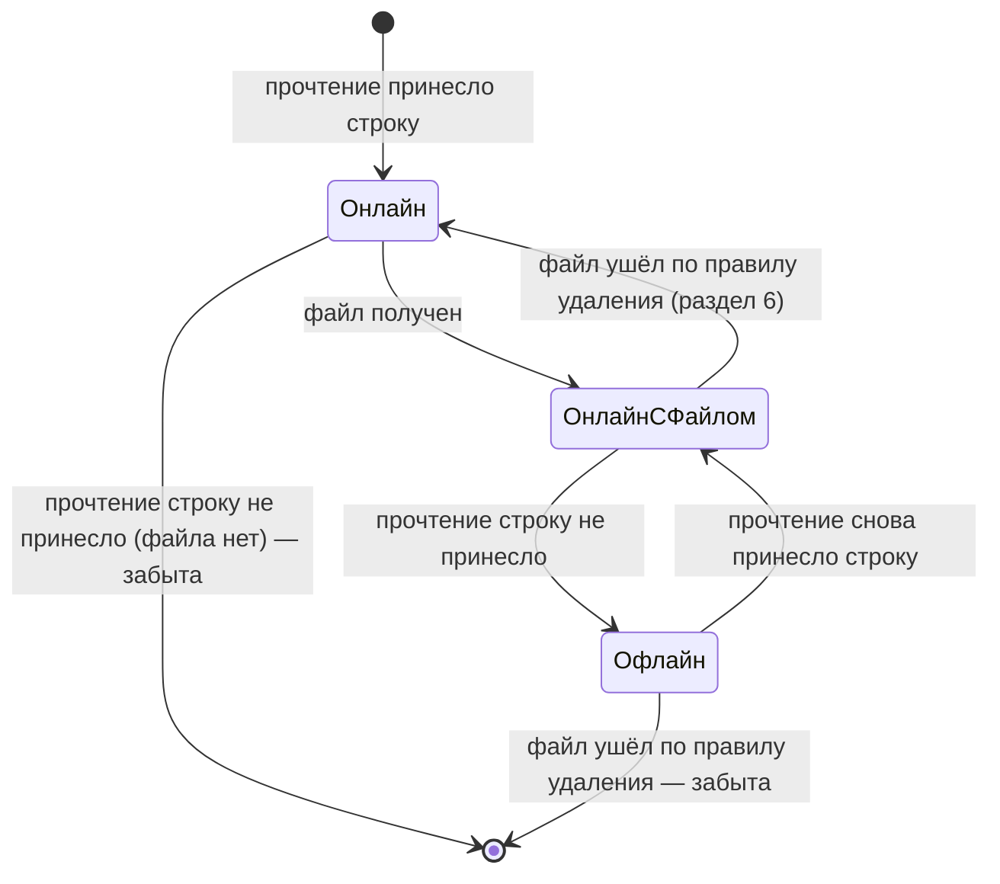

# Таблица серии: онлайн и офлайн — модель

Дата: 2026-11-08. Состояние: проект модели, к согласованию; кода нет. Требования дословно —
[СЛОВА_ВЛАДЕЛЬЦА.md](СЛОВА_ВЛАДЕЛЬЦА.md).

## 1. Суть

Источники непостоянны: канал удаляет старые серии, перезаливает их компиляцией, меняет ссылки. То, что система уже
получила (скачанное видео, выровненная озвучка, видео, вырезанное из компиляции), — актив. Он не зависит от того, есть
ли его строка в источнике сейчас.

У каждой серии своя таблица строк. Каждая строка отвечает на один вопрос: **онлайн** она (источник отдаёт её сейчас)
или **офлайн** (источник её больше не отдаёт, но за ней есть файл). Строка без файла, пропавшая из источника,
забывается. Строка с файлом живёт, пока жив файл, и участвует во всём наравне с онлайн-строками.

## 2. Термины

| Термин | Значение |
|---|---|
| Таблица источника | Строки одной страницы сайта или одного канала, одна таблица на источник. Плеер — поле строки: одна строка — одно видео одного плеера |
| Строка серии | Строка таблицы серии: видео или озвучка этой серии из одного источника и одного плеера, с тем, что назначили правила (сезон, серия, часть, группа озвучки) |
| Онлайн | Последнее полное и успешное прочтение источника принесло эту строку |
| Офлайн | Полное и успешное прочтение источника строку не принесло, а файл строки есть |
| Файл строки | Видео в библиотеке, дорожка озвучки в контейнере серии, видео, вырезанное из компиляции |
| Слепок | Происхождение файла, записанное в момент его получения: источник (сайт, канал или страница, название), плеер, группа озвучки и имя озвучки, как пришло, разрешение, ссылка, видео по счёту хоста |
| Забыть строку | Удалить её запись из всех таблиц; файл строки при этом удаляется следующей синхронизацией |

## 3. Строка серии

| Часть | Поля | Меняется |
|---|---|---|
| Тождество | источник, ключ строки в таблице источника, видео по счёту хоста | никогда: другое значение — другая строка |
| Назначено правилами | сезон, серия, часть, группа озвучки, исключена ли | при каждом прочтении, пока строка онлайн |
| Сейчас в источнике | ссылка, разрешения, доступность, название | при каждом прочтении, пока строка онлайн |
| Состояние | онлайн, офлайн | по прочтению источника (раздел 4) |
| Файл | путь видео или ключ дорожки в контейнере, ревизия файла | при получении и замене файла |
| Слепок файла | происхождение файла (раздел 2) | пишется один раз, при получении файла |
| Выравнивание (озвучка) | по какому видео выровнена дорожка: тождество строки референса и ревизия его файла | при каждом выравнивании |
| Родители (видео из компиляции) | слепок строки компиляции и слепок строки РЕФ 2, по которой резали; секунды из компиляции и из серии | пишется один раз, при приёме видео |

Слепок файла и «сейчас в источнике» — разные вещи. Источник может начать отдавать 1080p вместо 720p, а файл
остаётся тем, что скачано. Окно показывает оба.

## 4. Состояния строки

| Правило | Содержание |
|---|---|
| С-1 | Онлайн и офлайн решает только **полное и успешное** прочтение источника. Сбой сайта, прочтение не до конца, видео, которое канал скрыл из списка, состояние строки не меняют |
| С-2 | Строка без файла существует только онлайн |
| С-3 | Строка с файлом не забывается ни по какой причине, кроме правил удаления (раздел 6) |
| С-4 | Удалён источник или его профиль — все его строки с файлами становятся офлайн, строки без файлов забываются |

## 5. Участие офлайн-строки

Офлайн-строка — полноправный участник. Она стоит во всех таблицах окна (источники, очередь «РЕФ», озвучки, вкладки
раскрытой серии) с отметкой «офлайн» и слепком источника.

| Роль | Как участвует |
|---|---|
| Референс | Остаётся референсом, пока его не заменит лучший по правилам удаления У-2 и У-3 |
| Озвучка | Её дорожка остаётся в контейнере. При смене референса она **перевыравнивается из контейнера** (раздел 7) |
| Видео из компиляции | Остаётся референсом своей серии, когда компиляция или РЕФ 2 пропали из источника |
| Кандидат в новую работу | Новой загрузки по офлайн-строке нет: ссылки, которую можно скачать, нет |

## 6. Удаление файла — полный перечень

Файл строки удаляется только в этих случаях. Других путей удаления нет.

| № | Причина | Что уходит |
|---|---|---|
| У-1 | Пользователь снял галочку у серии, и синхронизация прошла | Все файлы серии; офлайн-строки забываются, онлайн остаются без файлов |
| У-2 | Вышел более подходящий референс: новое видео скачано, все озвучки перевыровнены по нему, контейнер собран | Прежнее видео. Его строка: онлайн — остаётся без файла, офлайн — забывается |
| У-3 | Обновилась компиляция или РЕФ 2: выше разрешение, приоритетнее источник, подходящая озвучка, РЕФ 2 сменён пользователем — и синхронизация прошла; новое видео вырезано, озвучки перевыровнены, контейнер собран | Прежнее видео из компиляции, как в У-2 |
| У-4 | Пользователь удалил офлайн-строку из таблицы серии | Запись — сразу; дорожка или видео — следующей синхронизацией |

Не удаляют файлов:
- пропажа строки из источника;
- сбой или неполное прочтение;
- удаление источника или профиля;
- изменение правил разбора и их новое прочтение;
- смена или снятие группы озвучки;
- исключение строки правилом;
- смена ключа или диапазона компиляции.

Они меняют только то, что берётся в **новую** работу.

## 7. Замена видео серии и перевыравнивание из контейнера

| Правило | Содержание |
|---|---|
| З-1 | Замена видео серии (У-2, У-3) атомарна: прежний контейнер живёт, пока не собран новый, в котором есть все участники прежнего |
| З-2 | Источник перевыравнивания озвучки — прежний контейнер. Он подаётся сервису выравнивания как озвучка с номером дорожки (`dub_atracks`): картинка прежнего видео и дорожка, синхронная с ней. Звук в контейнере без потерь, качество не теряется |
| З-3 | Если перевыравнивание хоть одной озвучки не удалось, замена не выполняется: серия остаётся на прежнем контейнере, в окне ошибка с выбором «Повторить» или «Удалить эту озвучку» (У-4) |
| З-4 | Озвучка, у которой есть живая онлайн-строка, может перевыравниваться и из свежей загрузки; выбор источника перевыравнивания — раздел 10, вопрос В-3 |

## 8. Слепок в самом файле

| Правило | Содержание |
|---|---|
| Ф-1 | Каждый контейнер MKV несёт вложение `provenance.json` (тип `application/json`): строки серии, которые в нём лежат, со слепками, выравниванием и родителями |
| Ф-2 | Вложение пишет сборка контейнера при каждой сборке. Сейчас сборка сбрасывает все метки и не переносит вложения (`core/container.py`, `-map_metadata -1`) |
| Ф-3 | База — рабочий указатель, файл — резерв. Таблицу серии можно восстановить из вложений её контейнеров («усыновление»), и сверка базы с файлами — штатная проверка |
| Ф-4 | Видео, ещё не собранное в контейнер (`.mp4` как скачано), вложения не держит: его слепок до первой сборки живёт только в базе |

Проверено на ffmpeg сервера: вложение JSON пишется, читается обратно байт в байт и переживает перепаковку с
сохранением всех потоков. Правка вложения без перезаписи файла требует `mkvpropedit` (mkvtoolnix), на сервере его нет.

## 9. Инварианты

| № | Инвариант |
|---|---|
| И-1 | Строка без файла — только онлайн (С-2) |
| И-2 | Строка с файлом уходит только по У-1…У-4 |
| И-3 | Каждая дорожка контейнера — ровно одна строка серии; каждая строка-озвучка с файлом — ровно одна дорожка |
| И-4 | Дорожка выровнена по видео своего контейнера (тождество и ревизия); иначе её перевыравнивают до сборки |
| И-5 | Слепок файла не меняется после получения файла |
| И-6 | Вложение контейнера совпадает с записью строк серии в базе |
| И-7 | Прежний контейнер не удаляется, пока новый не собран со всеми участниками (З-1) |

## 10. Дыры и противоречия

### Противоречия с действующими решениями

| № | Что | Решение модели |
|---|---|---|
| П-1 | Д-48 (этап 10): «источник или профиль сняты, строка исключена → файл убирается» (`scan/module.py` `_removed_by_configuration`, `downloads/library.py` `remove_unwanted`) | Отменяется в этой части: С-4, раздел 6 |
| П-2 | Р-77: озвучка без группы не в работу. Код при этом удаляет и уже выложенные дорожки такой озвучки (`voices/repository.py` `drop_unplanned`) | Готовые дорожки остаются строками серии; правило касается только новой работы |
| П-3 | Озвучка, исчезнувшая из сезона целиком (источник убран, канал удалил видео), уходит из плана, и синхронизация удаляет её дорожки (`drop_unplanned`) | Озвучка становится офлайн-строкой, дорожка остаётся |
| П-4 | Этап 12: видео из компиляции опознаётся ключом из группы, источника, плеера и диапазона. Сменилась любая часть — серия режется заново | Видео из компиляции — строка серии со слепками родителей; новый разбор только по У-3 |
| П-5 | Удержание референса держится на прошлой записи выбора и только пока источник числится в сериале (`scan/reference.py`) | Удержание — следствие модели: офлайн-строка с файлом остаётся референсом (раздел 5) |
| П-6 | Окно строит источники и очереди только из строк раскладки (Д-72) | Окно строит их из таблицы серии: онлайн-строки — как сейчас, офлайн — со слепком |

### Дыры, которые нужно решить владельцу

| № | Дыра | Факт | Предложение |
|---|---|---|---|
| В-1 | Правило перенумеровало строку: видео, которое лежит файлом серии 5, теперь читается как серия 6 | Сейчас референс следует новому номеру (`scan/reference.py`: «строка, которую раскладка нумерует иначе, — её слово») | Файл остаётся у серии 5 офлайн-строкой (слепок прежних номеров), строка-онлайн серии 6 — новый кандидат без файла |
| В-2 | Исключение строки правилом, выключенный плеер, выключенный сезон — это «снятая галочка» (У-1) или только «не брать в новую работу»? | Сейчас — удаление файлов (Д-48) | Сезон — как галочка (У-1); правило и плеер — только новая работа |
| В-3 | Сервис выравнивания по умолчанию заполняет паузы озвучки звуком референса (`fill_silence` = true, мы его не передаём: `voices/module.py`, постановка задачи). Выложенная дорожка — уже озвучка с вставками звука прежнего референса. Перевыравнивание из контейнера (З-2) перенесёт эти вставки, в том числе голос другой озвучки, если прежний референс был другой группы | Параметр сервиса, по умолчанию включён | Перевыравнивать из контейнера с вставками только при той же группе референса; иначе — из свежей загрузки, если строка онлайн. Нужно ваше слово, как сервис работает с уже заполненной дорожкой |
| В-4 | Звук видео из компиляции — смесь: середина — звук компиляции, края, которых в компиляции нет (`extend_edges`), — звук серии РЕФ 2. Дорожка подписана группой компиляции. При разных группах компиляции и РЕФ 2 это два голоса в одной «своей» дорожке | Живой разбор F: серия 101 — 909 с из компиляции и 316 с из серии | Разбор только при одной группе компиляции и РЕФ 2, или края без звука, или отдельная пометка смеси; решение за вами |
| В-5 | Пользователь удаляет офлайн-строку, которая сейчас **референс** (У-4). Контейнер с дорожками — единственная их копия, и без видео его не собрать | — | Удаление референса — только когда есть замена: идёт как У-2 (новое видео, перевыравнивание, сборка), до этого строка помечена «к удалению» |
| В-6 | Сайт перезалил видео под тем же ключом строки (другое видео по счёту хоста) | Сейчас строка с другим видео — снова кандидат | Новое видео — новая онлайн-строка; старый файл — офлайн-строка прежнего видео; обе в таблице серии |
| В-7 | Серии торрентов (qBittorrent) живут по своим правилам модуля `torrents` | — | Модель — для видео-сериалов с сайтов; торренты вне её |
| В-8 | Место работы в дорожной карте: этап 13 занят остановкой синхронизации | — | Отдельный этап с вашего согласия; состав — разделы 3–8 и решения В-1…В-6 |
