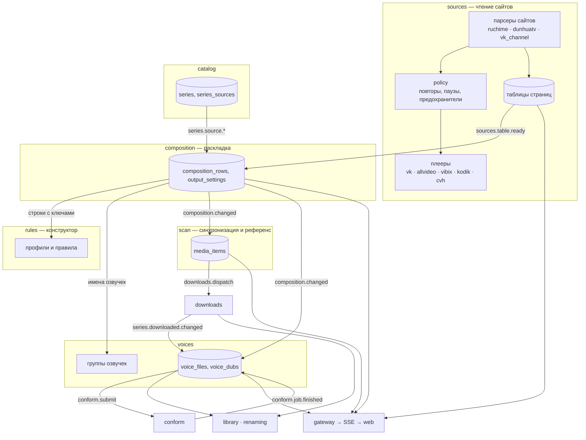

# Этап 10 — архитектура: сериал с несколькими источниками

> Дата: 2026-11-01; реализован 2026-11-02 (расхождения — `EXECUTION.md`, раздел 7). Жанр — справочник.
> Требования — `SPEC.md`; что из существующего кода перестраивается, удаляется или подтверждается — `REVISION.md`;
> инварианты — `LIFECYCLE.md`; проверка — `VERIFICATION.md`.

## 1. Принципы, на которых держится устройство

| Принцип | Что он значит в этом этапе | Откуда |
|---|---|---|
| Один путь данных | сайт → таблица страницы → конструктор → группы озвучек → раскладка → все потребители; другого пути к номеру серии или к содержимому сайта нет | `SPEC.md`, З-1, З-3, З-4 |
| Один владелец функции | у каждой функции один модуль; если новой функции нужно другое поведение существующего блока, блок перестраивается, а все его вызовы перечислены в `REVISION.md` | З-5 |
| Шина — сигнал, БД — истина | всё, что нужно для продолжения работы, записано в БД модуля-владельца до публикации события; при старте модуль добирает незавершённое из БД | `CLAUDE.md` проекта |
| Сигналы вместо времени | модули ждут событий готовности и провала; время — только как предмет задачи (срок таблицы, расписание) или предохранитель | закон об архитектуре |
| Модуль знает только `core` | модули общаются конвертами шины; чужие таблицы БД не читаются | `CLAUDE.md` проекта |
| Интерфейс без опроса | интерфейс получает изменения событиями сервера (SSE) и не спрашивает за подробностями | закон об интерфейсах |

## 2. Блоки и поток данных



## 3. Модули

| Модуль | Владеет данными | Делает | Не делает |
|---|---|---|---|
| `sources` | таблицы страниц (`release_tables`, `release_rows`), кэш торрент-файлов, трекеры | читает страницу сайта и все её плееры; строит полную таблицу; отдаёт поток перед загрузкой | не назначает номера; не знает сериалов и профилей |
| `catalog` | `series`, **новая** `series_sources`, статусы | сериалы и их источники: профиль, выбор по источнику, порядок | не читает сайты; не толкует строки |
| `rules` | профили и правила | отвечает на строки с ключами: исключена ли строка, сезон, серия или диапазон, часть, озвучка; форматирует имя файла по готовым номерам | не хранит номера; не применяет правила второй раз ради имени файла |
| `composition` (**новый**) | **новые** `composition_rows`, `unknown_voices`, `output_settings` | собирает раскладку сериала: строки таблиц всех его источников → конструктор → группы озвучек; хранит настройки выхода трёх уровней и считает итоговые настройки каждой серии; пересчитывает по событиям | не читает сайты; не выбирает референс; не качает |
| `voices` | `voice_files` (**новая**), `voice_dubs`, журнал очистки, настройки групп и приоритета | группы озвучек; озвучки серий по раскладке; загрузка до 720p; conform; дорожки рядом с референсом | не вычисляет номеров; не читает сайты |
| `scan` | `media_items`, задачи скана | синхронизация по расписанию и по команде; план референсов по раскладке и итоговым настройкам серий | не применяет правила; не читает сайты напрямую; не хранит настройки выхода |
| `downloads`, `library`, `renaming`, `conform`, `torrents`, `metadata` | свои таблицы | границы не меняются; изменения входов перечислены в `REVISION.md` (у `torrents` — адрес из источника сериала) | — |
| `slicing` | свои таблицы | код не трогается; в новой архитектуре не участвует: склейка не попадает в план, нарезка не вызывается | — |
| `gateway` | — | HTTP и SSE; переводит запросы в команды и запросы шины | бизнес-логики нет: ветвления по виду источника, фильтры, сборка ответов из нескольких модулей уходят в модули-владельцы |

## 4. Контракты (`core/contracts`)

### 4.1. Таблица страницы

| Уровень | Поле | Смысл |
|---|---|---|
| Шапка | `url` | адрес страницы (у канала VK — канал, запрос, режим поиска) |
| | `site` | `ruchime`, `dunhuatv`, `vk_channel` |
| | `names` | названия релиза так, как их пишет сайт (основное, оригинальное) |
| | `site_voice` | озвучка, которую называет сайт (ruchime: поле «Озвучка» страницы релиза); пусто, если сайт её не называет |
| | `read_at`, `complete` | время полного чтения; признак «прочитана полностью» |
| Строка | `key` | устойчивый ключ элемента у плеера: `vkId`, `cvhId`, `id` строки списка ruchime, `data-id` пункта Kodik, позиция сезона и серии в каталоге Vibix, `owner_id_id` видео VK |
| | `player` | вид плеера |
| | `group` | группа плеера, как он её называет: «Сезон 2», «1 сезон», число сезона CVH; пусто, если плеер групп не ведёт |
| | `text` | текст элемента, как его дал сайт: «Серия 2», «109-110 серия», заголовок видео VK |
| | `site_fields` | собственные числа и пометки сайта как справка: `number`, `compilation_from/to`, `value` пункта Kodik, `season`/`episode` CVH, `is_trailer` |
| | `voice` | озвучка в записи плеера (`{RuChiMe}` у потока Vibix, `voiceStudio` и `voiceType` CVH, `data-title` и `data-translation-type` Kodik); для страниц, где озвучка — сайт, — `site_voice` |
| | `heights` | ступени разрешения потока |
| | `state` | `playable` / `absent` / `not_obtained`, причина кодом `core/reasons` |
| | `duration_s`, `published` | длительность и дата — справка |
| | `link` | адрес кандидата для загрузки (поток разрешается перед загрузкой) |

Строка таблицы не содержит номеров серии и сезона, вычисленных парсером. Поле `site_fields` — справка для человека
и для отладки; его не читает ни один потребитель, принимающий решения.

### 4.2. Строка для конструктора

Собирается одной функцией `line_of(table, row)`; её же вызывает тест правил (`DECISIONS.md`, Д-30):

```
<название релиза> | <плеер> | <озвучка> | <тип озвучки> | <группа плеера> | <разрешение> | <текст строки>
```

| Правило образца | Пример |
|---|---|
| Порядок полей постоянный, текст сайта последний | `Асура: Безумный король 2 \| Vibix \| Ruchime \| Сезон 2 \| 1080p \| Серия 1` |
| Отсутствующее поле пропускается вместе с разделителем | `VK \| 2160p \| Непревзойденный царь небес - 525 серия 3 сезон (653 эпизод)` |
| Тип озвучки — как его называет плеер | `Практикуя ци сто тысяч лет \| Kodik \| Студия Константина Исаева \| voice \| 1 сезон \| 720p \| 1-3 серия` |
| Разрешение — наибольшая ступень строки; у строки в состоянии «нет» или «не получено» поле пропускается | — |
| Текст строки берётся дословно; только у CVH, где текста нет, он собирается из чисел плеера | `Практикуя ци сто тысяч лет \| CVH \| AniStar \| Многоголосый \| 1 сезон \| 1080p \| 5 серия` |

### 4.3. Ответ конструктора

`rules.apply {profile_id, lines: [{key, text}], series_season?}` →
`{results: {key: {excluded, season, episode | start, end, part, voiceover, events, errors}}, invalid_rules}`.
Сезон карточки сериала — запасной, когда правило сезон не извлекло (`core/season.resolve`).

### 4.4. Раскладка

| Поле строки раскладки | Смысл |
|---|---|
| `series_id`, `source_id`, `row_key` | откуда строка |
| `excluded` | конструктор исключил строку |
| `season`, `episode_start`, `episode_end`, `part` | номера, данные конструктором; `episode_end > episode_start` — склейка |
| `voice_group` | группа озвучки либо пусто |
| `voice_label` | имя группы либо «Неизвестная озвучка N» |
| `player`, `heights`, `state`, `link` | из строки таблицы |

Сводка по источнику для окна (число плееров, строк и групп у плеера, ступени разрешения) считается из таблицы тем же
модулем и отдаётся вместе с раскладкой.

### 4.5. Референс серии

| Поле | Смысл |
|---|---|
| `season`, `episode` | серия |
| `mark` | `by_level` (по настройкам уровня выше) / `own` (своя настройка серии) / `other_player` (у выбранного плеера серии нет, взят следующий) / `none` (нет референса) / `unfit` (только склейка) / `off` (серию отключил пользователь: сезон, номер серии или строка плана; референса и озвучек нет) |
| `source_id`, `row_key`, `player`, `height` | выбранная строка |
| `reason` | причина отметки кодом `core/reasons`; у `other_player` — какой плеер выбран и какого нет |

### 4.6. Настройки выхода

| Поле записи | Смысл |
|---|---|
| `series_id`, `season?`, `episode?` | уровень: без сезона — сериал; с сезоном — сезон; с сезоном и серией — серия |
| `lever` | имя рычага из реестра рычагов (`composition/levers.py`) |
| `target?` | к чему относится: источник и плеер, группа озвучки; пусто у рычага уровня целиком |
| `value` | значение рычага; записи нет — «как уровнем выше» |

| Рычаг | `target` | Значения | По умолчанию | Потребитель |
|---|---|---|---|---|
| `reference.choice` | — | авто / вариант | авто | `scan` |
| `variant.allow` | вариант: группа озвучки, источник, плеер (цель — JSON-массив) | участвует / не участвует | участвует | `scan` и `voices` |
| `voice.take` | группа озвучки | брать / не брать | брать | `voices` |
| `voice.player` | группа озвучки | авто / (источник, плеер) | авто | `voices` |

Реестр описывает рычаг видом цели (нет, группа, вариант) и формой значения (флаг, выбор варианта, выбор референса);
`composition.get` отдаёт описания (`levers`), и окно строит управление по ним: флаг варианта стоит в варианте, флаг группы —
в шапке колонки, выбор референса и предпочтительного варианта — отметками на варианте. Рычаг известной комбинации
(вид цели, форма) появляется в окне регистрацией; текст названия — ключ `output.lever.title.<имя>` каталога надписей,
а без ключа рычаг назван своим именем. Новая форма значения требует одного места в реестре (`accepts` по форме) и одного
вида управления в окне.

Настройки, заданные для группы озвучки, следуют за озвучкой: когда имя озвучки то же, а группа другая (озвучку назвали,
группу переименовали или распустили), пересчёт раскладки переносит записи на новое название (`settings.retarget`).
Итоговые настройки серии — чистая функция `effective(records, season, episode)`: значение серии, иначе сезона,
иначе сериала, иначе значение по умолчанию из реестра рычагов. Записи хранятся в терминах серии и сущностей домена
(номера от конструктора, имя группы озвучки, источник сериала, вид плеера), поэтому переживают новое чтение таблицы.

### 4.7. Допустимое по статусам и снятие работы

| Контракт | Смысл |
|---|---|
| `availability` (`core/contracts/availability.py`) | таблица «действие → состояния объекта, в которых оно допустимо» (`sync`, `cancel_download`, `choose_reference`, `prefer_variant`); `allowed`, `require`, `refusal`, `variant_state`; отказ — причина `not_allowed` с действием и состоянием, шлюз отвечает 409. Таблица идёт в `CompositionReply.availability`, окно включает управление по ней |
| `work` (`core/contracts/work.py`) | уведомление `work.withdrawn {series_id, keys?}`: владелец работы публикует «не нужна», исполнитель (загрузки) сам останавливается и убирает своё |
| Статус плана `removed` | строка отключённого сезона, снятого источника или профиля: плану не нужна, её целый файл убирает `downloads` (Д-48, Д-55); причину называет `scan._removed_by_configuration` |
| Задача загрузки | рабочий приказ: адрес берётся у строки при старте (`claim`), `save_path` — проекция плана, путь рабочего файла — поле `work_path`; файл получает имя через статус `publishing` и одну транзакцию (`finish_publish`), задача уходит одним путём (`_discard_tasks`), живые состояния — `LIVE_STATES` (Т-46, Т-53) |
| Модуль `downloads` | `module.py` — шина, очередь и воркеры; `library.py` (`Library`) — имена и файлы медиатеки, рабочие файлы, уборка; `publication.py` (`Publication`) — постановка файла под имя, доводка недоделанного (И-35, И-43); `repository.py` — весь SQL |
| `Gaps` (`core/ffprobe.py`) | исход проверки видео: проверено / найдены дыры / проверить не удалось (Т-45) |

## 5. Каталог событий и запросов

Шина внутрипроцессная: каждый подписчик получает каждое подходящее сообщение один раз в порядке публикации, в
неограниченную очередь; сообщения не переживают перезапуск. Поэтому каждый обработчик идемпотентен, а
продолжение работы после перезапуска берётся из БД. Каждый конверт несёт `correlation_id`.

### 5.1. Запросы и команды

| Топик | Вид | Владелец | Вход → выход |
|---|---|---|---|
| `sources.table.get` | запрос | `sources` | `{url}` → `{state: ready \| reading \| failed, table?, reason?}`; при истёкшем сроке начинает чтение |
| `sources.table.read` | команда | `sources` | `{url}` — прочитать сейчас, если чтение не идёт (ручная синхронизация) |
| `sources.video.stream` | запрос | `sources` | без изменений: поток кандидата перед загрузкой |
| `catalog.sources.list` | запрос | `catalog` | `{series_id}` → источники сериала |
| `catalog.sources.add` / `.update` / `.remove` | команда | `catalog` | источник, профиль, выбор по источнику, порядок |
| `rules.apply` | запрос | `rules` | см. 4.3 |
| `rules.format_filename` | запрос | `rules` | имя файла по номерам раскладки; правила повторно не применяются |
| `voices.groups.resolve` | запрос | `voices` | `{names}` → группа каждого имени |
| `composition.get` | запрос | `composition` | `{series_id}` → строки раскладки, сводка по источникам, итоговые настройки серий |
| `composition.settings.set` | команда | `composition` | `{series_id, season?, episode?, lever, target?, value}` — значение рычага уровня |
| `composition.settings.reset` | команда | `composition` | `{series_id, season?, episode?}` — уровень возвращается в наследование |
| `scan.series.run` | запрос | `scan` | синхронизация сериала |
| `scan.output.get` | запрос | `scan` | референс каждой серии (4.5) |

### 5.2. События

| Событие | Владелец | Данные | Подписчики |
|---|---|---|---|
| `sources.table.progress` | `sources` | `url, phase, current, total` | gateway (SSE) |
| `sources.table.ready` | `sources` | `url, read_at` | composition, gateway |
| `sources.table.failed` | `sources` | `url, reason` | composition, scan, gateway |
| `series.source.added` / `.updated` / `.removed` | `catalog` | `series_id, source_id` | composition, gateway |
| `rules.profile.changed` | `rules` | `profile_id` | composition |
| `voices.settings.changed` | `voices` | без изменений | composition, gateway |
| `composition.changed` | `composition` | `series_id, rev, episodes` (затронутые серии; пусто — весь сериал) | scan, voices, gateway |
| `composition.failed` | `composition` | `series_id, reason` | scan, gateway |
| `scan.reference.changed` | `scan` | `series_id, season, episode, mark` | voices, gateway |
| `voices.dub.changed`, `voices.dubs.snapshot` | `voices` | без изменений | gateway |
| `work.withdrawn` | `voices` (владелец работы) | `series_id, keys?` (ключи выданной работы; без ключей — вся работа сериала) | `downloads` |

Топики, уходящие из шины, перечислены в `REVISION.md`. Карта топиков проекта `contracts/bus_topics.md` обновляется
в том же заходе.

## 6. Исходы операций

| Операция | Сигнал успеха | Сигнал провала | Что видит пользователь при провале |
|---|---|---|---|
| Чтение таблицы страницы | `sources.table.ready` | `sources.table.failed` (причина) | у источника — причина; действует прежняя полная таблица |
| Пересчёт раскладки | `composition.changed` | `composition.failed` (причина) | у сериала — причина; действует прежняя раскладка |
| План референса серии | `scan.reference.changed`, `mark: by_level \| own \| other_player` | `mark: none \| unfit \| off` с причиной | у серии — «нет референса», «референс не подходит» или «серия отключена» и причина |
| Изменение рычага | `composition.changed` с затронутыми сериями | отказ команды с причиной (рычаг или значение не из реестра) | у рычага — причина отказа |
| Загрузка референса | `series.downloaded.changed` | ошибка задачи загрузки | состояние загрузки (без изменений) |
| Загрузка и conform озвучки | `voices.dub.changed` до `done` | `voices.dub.changed` в `error` с причиной | семь состояний озвучки (без изменений) |
| Синхронизация сериала | все шаги завершены своим сигналом | первый сигнал провала шага | состояние скана сериала с причиной |
| Передача работы исполнителям | ответы `downloads.dispatch` и `voices.dispatch` после записи у получателей | отказ получателя: провал синхронизации с причиной, команда остаётся | состояние сериала с причиной; повтор синхронизации даёт работу снова |
| Работа стала не нужна | исполнитель остановился и убрал своё (`work.withdrawn`, статус плана вне плана) | — | загрузка серии исчезла, файл убран, строка «не загружена» |

## 7. Числа со временем

| Число | Категория | Источник величины |
|---|---|---|
| Срок таблицы страницы — 1 час | предмет задачи | требование владельца (`SPEC.md`, Т-2) |
| Расписание автоскана | предмет задачи | настройка пользователя (без изменений) |
| Интервал запросов к страницам ruchime — 0,6 с | предмет задачи (ограничение частоты хоста) | замер Р-33 |
| Таймауты запросов к сайтам и плеерам, попытки | предохранитель | `modules/sources/policy.py`, `core/retry.py` (без изменений) |
| Ожидание синхронизацией сигнала готовности таблицы | предохранитель | двойная измеренная цена полного чтения страницы (`VERIFICATION.md`, М-2) |

Других чисел со временем этап не вводит; паузы между модулями не применяются.

## 8. Данные и миграции

| Миграция | Владелец | Что делает | Существующие данные |
|---|---|---|---|
| таблицы страниц | `sources` | `release_tables`, `release_rows` | новые, пусты до первого чтения |
| источники сериала | `catalog` | `series_sources` для каждого сериала, включая торрентные; `url`, `source_type`, `parser_profile_id`, `vk_search_mode` переходят к источнику; выбор из адреса (`?vibix=`, `?off=`, `?player=`, `?voice=`) — в поля источника; `vk_quality_priority` удаляется | каждый сериал получает один источник со своими значениями; торрент-сериал работает как прежде |
| раскладка | `composition` | `composition_rows`, `unknown_voices`, `output_settings` | строятся при первом пересчёте; настроек выхода нет — действуют значения по умолчанию |
| референс | `scan` | у `media_items` — ссылка на строку раскладки и отметка (4.5) | сериалы VK и сайтов прежней версии прежнего поведения не сохраняют и пересоздаются пользователем (`DECISIONS.md`, Д-35); их записи удаляются штатным удалением сериала, файлы медиатеки остаются |
| озвучки | `voices` | `voice_files` (файл строки источника, общий для серий диапазона); `voice_dubs` ссылается на файл; `site_episode` уходит | прежние строки озвучек уходят вместе с прежними сериалами |
| отчёт о плеерах | `scan` | `video_availability` удаляется: его данные — состояния строк таблицы | удаляется |

Перед каждой миграцией — бэкап `app.db`. Порядок применения и откат — `VERIFICATION.md`, М-32.

## 9. Интерфейс

| Часть | Устройство |
|---|---|
| Компонент источников | один компонент для окна добавления и окна сериала: группа на источник → плееры → озвучки; у озвучки — группа или «нет группы»; у источника — профиль конструктора, выбор сезона каталога, отключённые плееры |
| Раздел «Выход» | заменяет вкладку «Композиция» сериалов VK и сайтов. Заголовок сериала, заголовки сезонов, карточки серий; у серии — референс (источник, плеер, разрешение), отметка (4.5), озвучки в семи состояниях. Заголовок и карточка компактны и раскрываются до всех рычагов (4.6); фильтр «только отклонения». Каждый рычаг — компонент своего вида значения (выбор из списка, участвует / нет), подключаемый по реестру рычагов; оформление прорабатывается вне этапа |
| Данные | состояние в сервере; события SSE `sources_table_progress`, `sources_table_ready`, `composition_changed`, `reference_changed`, `voice_dub_update`; пакет события самодостаточен для своего участка экрана |
| Тексты | ключи `web/src/i18n/ru.ts` (`sources.*`, `output.*`) |
| Раскладка | интринсик: примитивы Stack, Cluster, Sidebar, сетки `auto-fit`, размеры через `clamp()`; пороги по ширине не применяются |
| Логика строк | чистые функции в `web/src/lib/`, покрыты тестами Vitest |

## 10. Файловая раскладка

```
core/contracts/
    release_table.py      таблица страницы, строка, line_of
    composition.py        строка раскладки, сводка источника
    output_settings.py    запись настройки выхода, итоговые настройки серии
    reference.py          референс серии и отметка
modules/sources/
    module.py             sources.table.*, sources.video.stream
    repository.py         release_tables, release_rows
    table.py              сборка таблицы, срок, одно чтение на страницу
    sites/ruchime/        страница релиза, список серий, плееры страницы, каталог Vibix
    sites/dunhuatv/       страница, CVH, Kodik со всеми озвучками и сезонами
    sites/vk_channel/     канал VK по запросу
    players/              vk, vk_files, allvideo, vibix, vibix_protocol, kodik, cdnvideohub, contract, http
    policy.py             без изменений
modules/catalog/          series_sources: repository, команды, события
modules/rules/            rules.apply по ключам, rules.profile.changed, format_filename по готовым номерам
modules/composition/      module.py, repository.py, project.py (чистая функция раскладки),
                          levers.py (реестр рычагов), settings.py (наследование, чистая функция)
modules/voices/           groups.resolve, озвучки по раскладке, voice_files, layout.py без авторежима,
                          identity.py без склейки по составу имени
modules/scan/             синхронизация, план референсов, planner.py, reference.py (ключи ранжирования кандидатов)
modules/gateway/          эндпоинты источников, раскладки, выхода, референса; SSE_MAP
web/src/components/       компонент источников, раздел «Выход»
web/src/lib/              логика строк источников и выхода
alembic/versions/         миграции раздела 8
```

## 11. Как соблюдается запрет «пришивать сбоку»

| Механизм | Где |
|---|---|
| Каждая точка старого кода, через которую проходит этап, имеет статус «подтверждена / перепроектирована / удалена» с местами вызова | `REVISION.md` |
| Удалённая точка удаляется в том же заходе вместе с вызовами; параллельной жизни старого и нового пути нет | `REVISION.md`, столбец «Вызовы» |
| Каждая функция этапа отнесена к одному модулю раздела 3 | этот документ |
| Проверка полноты реестра и отсутствия дублей — измерение приёмки | `VERIFICATION.md`, М-31 |

## 12. Точки расширения

Каждый узел принимает новое регистрацией в своём реестре или контракте. Если добавление требует правки соседнего
узла, контракт узла неполон: он перестраивается (`DECISIONS.md`, Д-27, Д-43), а не обходится.

| Что добавляется | Где и как | Что не меняется |
|---|---|---|
| Сайт | каталог `modules/sources/sites/<сайт>/`: контракт сайта «прочитать страницу → шапка и строки таблицы»; запись в реестре сайтов по домену | таблица страницы, срок, одно чтение на страницу, `composition`, `scan`, `voices`, компонент источников |
| Плеер | `modules/sources/players/<плеер>.py` по контракту `find / fetch / read / owns / stream` (поток ссылки с границей высоты; `resolve_stream` перебирает зарегистрированные плееры и не называет ни одного); сайт перечисляет плееры, которые встречает; место в приоритете — настройка `voices.source_priority` | политика повторов, таблица, потребители |
| Поле строки таблицы | контракт `core/contracts/release_table.py` и сайт, который его заполняет; если поле нужно конструктору — только `line_of` | потребители, которым поле не нужно |
| Действие конструктора | реестр действий `modules/rules/engine.py` и поле ответа `rules.apply`; использование — `composition/project.py` | сайты, `scan`, `voices` |
| Рычаг выхода | запись в реестре `modules/composition/levers.py`: имя, вид цели, форма значения, значение по умолчанию, потребитель; окно рисует его по описанию ядра, значений по умолчанию не хранит; ключ названия в каталоге надписей | хранение `output_settings`, наследование `effective`, команды и события настроек |
| Критерий выбора референса | ключ ранжирования в `modules/scan/reference.py`; порядок ключей — список в одном месте (сейчас: разрешение, приоритет плеера) | раскладка, загрузка, озвучки |
| Потребитель раскладки | подписка на `composition.changed` и запрос `composition.get` | `composition` |
| Отметка серии или причина | код в `core/reasons`, ключ текста в `web/src/i18n/ru.ts` | логика модулей, кроме издателя отметки |
| Событие или запрос шины | каталог раздела 5 и `contracts/bus_topics.md`; сторож `bus_catalog.py` | шина |

Расширяемость проверяется измерением `VERIFICATION.md`, М-34: в тестах добавляются поддельные сайт, плеер, рычаг,
критерий референса и потребитель раскладки только через перечисленные точки.
