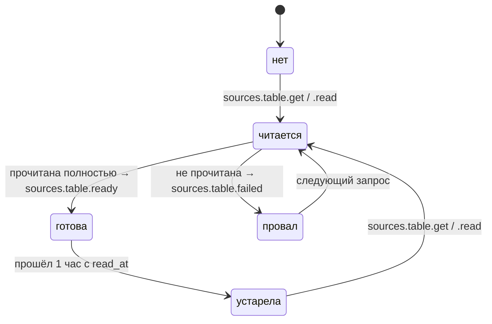
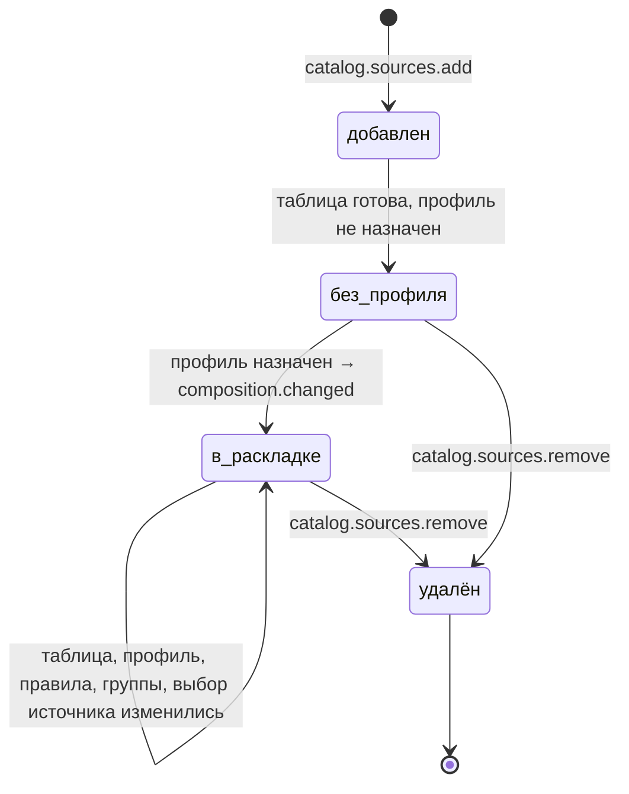
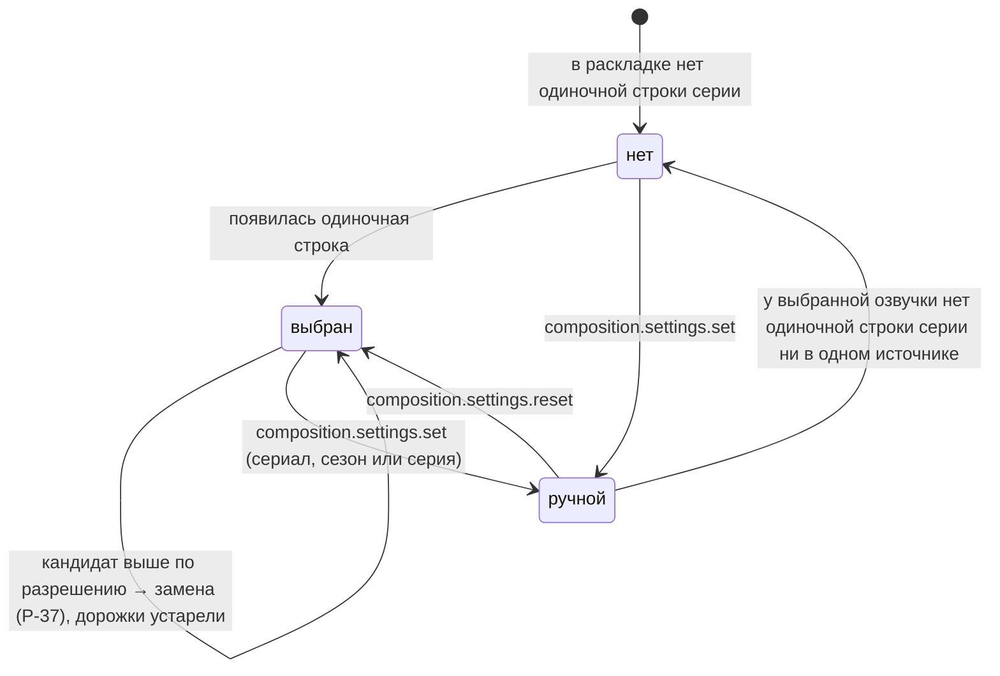

# Этап 10 — жизненные циклы и инварианты

> Дата: 2026-11-01. Состояние: проект. Жанр — справочник.
> Инварианты ресурсов озвучек (файлы, задачи сервиса выравнивания, журнал очистки) — `../LIFECYCLE.md`, И1–И10;
> они остаются в силе. Здесь — сущности этапа 10 и сочетания операций, которые проверяются до реализации.

## 1. Состояния

### 1.1. Таблица страницы

Пока таблица в состоянии «читается» или «провал», потребителям отдаётся последняя готовая таблица страницы, если она
есть (П-5).

### 1.2. Источник сериала

### 1.3. Референс серии

### 1.4. Озвучка серии

Семь состояний озвучки (запланирована, в очереди на загрузку, загрузка, в очереди на выравнивание, выполняется,
готова, ошибка) — без изменений (Р-44). Новое: файл склейки принадлежит строке источника и служит каждой серии своего
диапазона.

## 2. Инварианты

| № | Инвариант | Чем держится | Проверка |
|---|---|---|---|
| И-11 | Каждый номер серии, сезона, диапазона и части в системе (раскладка, `media_items`, `voice_dubs`, имя файла) происходит из ответа конструктора на строку источника с назначенным профилем | номера пишет только `composition`; остальные модули получают их из раскладки | М-12, М-31 |
| И-12 | Одну страницу в каждый момент читает не больше одного процесса чтения | замок страницы в `sources`, состояние «читается» в БД | М-5 |
| И-13 | Потребитель видит только полностью прочитанную таблицу | событие `ready` и запрос `get` отдают только `complete` | М-4 |
| И-14 | Раскладка сериала — чистая функция от таблиц его источников, профилей с их версиями, групп озвучек и выбора по источникам; одинаковые входы дают одинаковые строки | `composition/project.py` без сети, времени и состояния | М-14 |
| И-15 | Пересчёт раскладки идемпотентен; `rev` растёт; потребитель действует по последнему `rev` | `composition_rows` пишется одной транзакцией вместе с `rev` | М-14 |
| И-16 | У серии не больше одного референса; это строка одиночной серии; автовыбор — наибольшее разрешение, затем приоритет плеера | план `scan` | М-18, М-19 |
| И-17 | Ручной выбор хранится в терминах серии (сезон, серия → группа озвучки, источник, плеер) и переживает новое чтение таблицы; нет строки у выбранного плеера — следующий плеер той же озвучки; нет у озвучки нигде — у серии нет референса, причина названа | `output_settings` | М-21, М-22 |
| И-18 | Озвучка серии — строка той же раскладки другой группы, покрывающая серию; файл склейки удаляется, только когда ни одной серии его диапазона он больше не нужен | `voice_files` и журнал очистки | М-17 |
| И-19 | Номер неизвестной озвучки постоянен для того же имени в том же сериале | `unknown_voices` | М-15 |
| И-20 | Таблица страницы общая: два сериала с одной страницей читают её один раз; у каждого сериала своя раскладка по своему профилю | ключ таблицы — адрес страницы | М-5, М-14 |
| И-21 | После перезапуска каждое незавершённое состояние восстанавливается из БД: чтение страницы, пересчёт раскладки, план, озвучки | `on_start` модулей | М-26 |
| И-22 | Итоговое значение каждого рычага серии определено однозначно: своё значение серии, иначе сезона, иначе сериала, иначе значение по умолчанию из реестра; функция наследования одна, потребители её не повторяют | `composition/settings.py::effective` | М-33 |
| И-23 | Изменение или сброс рычага уровня меняет итог только тех серий, которые наследуют этот уровень; серии со своим значением этого рычага не затрагиваются | `effective`, `composition.changed.episodes` | М-33 |
| И-24 | Запись настройки ссылается только на сущности домена (номер от конструктора, имя группы озвучки, источник сериала, вид плеера); удаление источника снимает его записи вместе с ним | `output_settings`, `catalog.sources.remove` → `series.source.removed` | М-33 |

## 3. Сочетания операций

Каждое сочетание до реализации разбирается на модели: какие инварианты затронуты, какой исход ожидается. Каждое
становится тестом модуля или системным тестом (`VERIFICATION.md`, уровни 2–3).

| № | Сочетание | Ожидаемый исход | Инварианты |
|---|---|---|---|
| С-1 | Таблица перечитана, пока раскладка пересчитывается по прежней | итог — раскладка по новой таблице; промежуточная не публикуется после новой | И-14, И-15 |
| С-2 | Профиль источника изменён во время синхронизации | синхронизация завершает текущий шаг; план строится по последнему `rev` раскладки | И-15 |
| С-3 | Источник удалён, пока его озвучки качаются | загрузки отменяются, файлы уходят журналу очистки, строки озвучек — из плана | И-18, И1 `../LIFECYCLE.md` |
| С-4 | Группа озвучки заведена, пока идёт conform | ключ озвучки серии не меняется посреди задачи; новые серии идут под группой | И-19 |
| С-5 | Референс серии заменён, пока озвучка этой серии качается для прежнего | дорожки прежнего референса устарели; озвучка выравнивается по новому | И-16, Р-42 |
| С-6 | Склейка-озвучка «1-3»: серия 1 выровнена, серии 2 и 3 ждут, таблица перечитана и строка склейки изменилась | файл остаётся, пока он нужен ждущим сериям по прежней строке; по новой строке — новый файл | И-18 |
| С-7 | Ручной выбор серии, строки которой нет | у серии нет референса, причина названа; автовыбор её не подменяет | И-17 |
| С-8 | Перезапуск посреди чтения страницы | чтение начинается заново; потребители получают `ready` или `failed` | И-12, И-21 |
| С-9 | Два сериала на одной странице с разными профилями | одно чтение; две раскладки | И-20 |
| С-10 | Чтение страницы не удалось | действует прежняя полная таблица, раскладка не меняется, причина видна у источника | И-13 |
| С-11 | Строка, бывшая референсом, исчезла из новой таблицы | референс серии пересчитан; если кандидата нет — «нет референса» | И-16, И-17 |
| С-12 | Профиль снят с источника | строки источника выходят из раскладки; их кандидаты и озвучки выходят из плана | И-11 |
| С-13 | Референс сезона задан, у серии 34 VK исключён и выбран Kodik; затем референс сезона изменён | серия 34 сохраняет свой выбор; остальные серии сезона следуют новому выбору | И-22, И-23 |
| С-14 | Сброс серии к сезону, пока её озвучка выравнивается по прежнему референсу | референс серии пересчитан; если он сменился — дорожки прежнего устарели (Р-42) | И-16, И-23 |
| С-15 | Озвучка выключена на сезоне, у одной серии включена | озвучка берётся только для этой серии | И-22 |
| С-16 | Удалён источник, на который ссылается настройка серии | запись настройки снята; серия наследует уровень выше | И-24 |
| С-17 | Новое чтение таблицы изменило номера конструктора (правило поменяли) | настройки по номерам серий остаются за номерами; серии, номер которых исчез, теряют свои записи вместе с выходом из раскладки | И-17, И-24 |
