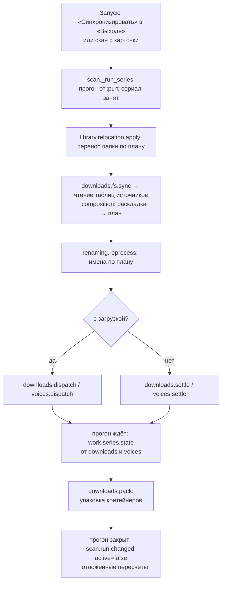

# ТЗ на независимое ревью этапа 11

Дата: 2026-11-05. Состояние: актуален. Круг 1.

## 1. Предмет и цель

`series-tracker` — медиасервер: находит серии сериалов на трекерах и сайтах, качает их, приводит имена к правилам и
складывает в медиатеку. Это один процесс asyncio: «тупая» шина (`core/bus.py`) и модули (`modules/*`), которые
общаются конвертами event / command / query / reply; у каждой таблицы БД ровно один модуль-владелец. Видео-сериал
может иметь несколько источников (сайты, канал VK). Из них строится раскладка серий, по ней выбирается видео-основа
(референс) каждой серии, а остальные озвучки выравниваются под основу внешней службой (conform).

Этап 11 закрывает цикл: на выходе серии лежит не видео с дорожками рядом, а собранный контейнер MKV.

**Предмет ревью:**

| Часть | Суть | Норматив |
|---|---|---|
| Контейнер серии | один MKV: видео основы, его звук и озвучки в порядке сезона; перепаковка без лишних загрузок и выравнивания | `ЭТАП_11.md` (слова владельца, дословно), И-61, Д-81 |
| Порядок озвучек сезона | список с перетаскиванием в окне «Выход»; по умолчанию — порядок добавления | `ЭТАП_11.md`, Д-81 |
| Синхронизация — один прогон | сериал занят до конца всех работ прогона; прогон работает по слепку правил | `ЭТАП_11.md`, И-60, Д-80 |
| Диск меняется только в синхронизации | пересчёт плана по событию меняет только план; перенос папки сериала — первый шаг синхронизации | И-59, Д-79 |
| Решения, вошедшие в тот же диапазон | «исключено — снять, пропало из таблицы — держать» (И-58, Д-77); прогресс чтения сайтов при скане (Д-78) | `stage-10/DECISIONS.md`, `stage-10/LIFECYCLE.md` |

**Цель:**
1. Установить, выполнены ли требования раздела 5.
2. Найти дефекты и назвать их класс со всеми носителями.
3. Оценить компромиссы (раздел 7) и ответить на вопросы раздела 8.
4. Вынести итог: готово / готово после исправления блокеров / не готово.

## 2. Область и порядок чтения

| Что | Значение |
|---|---|
| Репозиторий | ветка `main`; диапазон `0248328..515a8c2`, 11 коммитов |
| Объём вне документов | 95 файлов, +3 388 / −542 строки (без сгенерированного `web/src/api/schema.d.ts`) |
| Миграции | `0035` (причина исключения строки `source`), `0036` (`voice_orders` — порядок озвучек сезона), `0037` (`voice_dubs.aligned_to`) |
| Интерфейс | `web/src` (Vue 3 + TS): окно «Выход», карточка сериала, порядок озвучек, прогресс чтения |

Коммиты диапазона:

| Коммит | Содержание |
|---|---|
| `4e2bdec` | исключено — снять, пропало из таблицы — держать (И-58) |
| `d743185` | прогресс скана сериала: пилюля на карточке и строки в «Выходе» |
| `4265640` | исключение строки правилом не удаляет файл вне синхронизации |
| `546b770` | диск меняется только в синхронизации (И-59) |
| `40a1576` | синхронизация — один прогон, сериал занят (И-60) |
| `5904d9b` | тест окна: при занятом сериале кнопки и рычаги недоступны |
| `a946c74` | порядок озвучек сезона: ядро и окно |
| `fb0e93f` | файл серии — собранный MKV, упаковка — последний шаг прогона (И-61) |
| `d26edcd` | запись озвучки следует контейнеру (видео, под которое выровнена дорожка) |
| `0532f6a` | дорожка в контейнере видна в окне как «в контейнере серии» |
| `515a8c2` | перенос папки сериала — в синхронизации, сохранение карточки только записывает план |

**Порядок чтения:**
1. `docs/missions/voice-alignment/stage-11/ЭТАП_11.md` — требования владельца дословно. Это первичный норматив; всё остальное — толкование автора.
2. `stage-11/DESIGN.md` — устройство.
3. `stage-10/DECISIONS.md` — Д-77…Д-81.
4. `stage-10/LIFECYCLE.md` — И-56, И-58…И-61.
5. `contracts/bus_topics.md` — топики шины.
6. Код (раздел 4).

Документы описывают намерение автора, а не доказательство: каждое утверждение проверять по коду и прогону.

## 3. Запуск

| Что | Команда | Ожидание |
|---|---|---|
| Миграции | `ST_DB_URL=sqlite:///<файл> .venv/bin/python -m alembic upgrade head` | без ошибок |
| Откат миграций этапа | `… alembic downgrade 0034`, затем `upgrade head` | автором на этом этапе не прогонялся |
| Серверные тесты | `.venv/bin/python -m pytest -q -p no:cacheprovider tests` | прошли 3 131, пропущен 1; красные — только из строк ниже |
| Заведомо красные: нет данных прежней системы | `test_rules_format_diff` (1), `test_sources` (3), `test_scan_ids` (2 ошибки) | регрессией не считаются |
| Заведомо красные: нет снятых ответов сайтов | `test_composition_project` (4), `test_sources_ruchime_site` (9 + 11 ошибок), `test_sources_dunhuatv_site` (9 + 9 ошибок), `test_sources_vk_channel` (28), `test_sources_recent` (3) | сообщение «нет образца <файл>»: образцы с подписанными ссылками вне git |
| Тест контейнера | `tests/test_container.py` | нужны `ffmpeg` и `ffprobe` в `PATH`: собирает и читает настоящие MKV |
| Тесты интерфейса | `cd web && npx vitest run src` | 332 прошли; запуск без `src` подхватывает сценарии Playwright и падает |
| Сборка интерфейса | `cd web && npm ci && npm run build` | без ошибок |

**Время.** Полный серверный набор идёт дольше трёх минут. Автор гонял его группами со своим ограничением на группу. Самые долгие файлы:
- `test_voices.py` — около 130 с;
- `test_downloads_model.py` вместе с `test_downloads_module.py` — 367 тестов, около 220 с;
- `test_scan_video.py` — около 70 с.

Время колеблется от нагрузки хоста.

## 4. Карта устройства

Прогон синхронизации:

| Место | Роль в этапе |
|---|---|
| `core/container.py` | сборка MKV через `ffmpeg -c copy`, чтение через `ffprobe`; метки `ST_VIDEO`, `ST_VOICE`, `ST_ALIGNED_TO`, `ST_OWN`; тождество видео `identity(source_id, row_key)`; готовность доказывается чтением результата, а не кодом возврата |
| `modules/downloads/packing.py` | упаковка всех слотов сериала, последний шаг прогона: победитель слота, вытесненные им файлы, дорожки; сборка под временным именем `.st-pack.<id>.mkv`, одна замена, затем уборка |
| `modules/scan/module.py` | прогон: `_run_series`, `_relocate`, `_sync_video`, `_hand_over`, `_hold_run`, `_close_run`, `_resume`, `_require_idle` |
| `modules/composition/` | порядок озвучек сезона (`season_orders`, `reorder`, таблица `voice_orders`); заморозка раскладки на время прогона (`_frozen`, отложенные пересчёты) |
| `modules/voices/` | `aligned_to` у записи озвучки; `voices.tracks.get` / `voices.tracks.packed`; `_follow` — дорожка следует за тем же видео в другом разрешении; `ref_atrack` для выравнивания по контейнеру; подсказка `packed` |
| `modules/library/` | план переноса папки (`library.relocation.plan` / `get`) и перенос в синхронизации (`apply`) |
| `modules/catalog/module.py`, `core/contracts/availability.py` | отказ в правках занятого сериала (`Action.EDIT`); шлюз переводит отказ в HTTP 409 |
| `modules/rules/formatter.py` | у видео-сериала расширение `.mkv`, если исходник `.mkv` |
| `core/deadlines.py` | без собственного срока: `downloads.pack`, `library.relocation.apply` (у каждого шага внутри свой) |
| `web/src/components/status/VoiceOrder.vue`, `StatusOutput.vue`, `OutputEpisode.vue`, `StatusProperties.vue` | порядок озвучек перетаскиванием; занятость окна; подпись дорожки; путь переноса в карточке |

## 5. Требования, по которым оценивается результат

Обозначения Т11-N введены этим документом. Каждое требование выведено из `ЭТАП_11.md` или из решений, названных в
разделе 1.

| № | Требование | Где | Тесты |
|---|---|---|---|
| Т11-1 | Файл серии видео-сериала после синхронизации — один MKV: видео основы, его звук и озвучки в порядке сезона; первая дорожка — по умолчанию; ничего не перекодируется | `core/container.py`, `downloads/packing.py` | `test_container`, `test_downloads_packing` |
| Т11-2 | Порядок озвучек задаётся на уровне сезона перетаскиванием, строка списка — «озвучка (1–50)»; по умолчанию — порядок добавления источников; новая озвучка встаёт в конец и никого не сдвигает; переставляет только пользователь | `composition/project.py` (`season_orders`, `reorder`), `VoiceOrder.vue` | `test_composition_project`, `test_composition_module`, `VoiceOrder.test.ts` |
| Т11-3 | Смена порядка ведёт только к перепаковке: без загрузок и без выравнивания | `packing.py` (контейнер — функция плана) | `test_downloads_packing` |
| Т11-4 | БД знает, что упаковано в контейнер; сам контейнер несёт метки содержимого | `voices/repository.py` (`mark_packed`), метки `ST_*` | `test_voices`, `test_container` |
| Т11-5 | Отсутствие первой по порядку озвучки не мешает остальным: серия собирается из того, что есть, и выравнивается по доступной основе | `packing.py`, `scan/reference.py` | `test_downloads_packing`, `test_scan_reference` |
| Т11-6 | То же видео (тот же источник и строка) в другом разрешении не требует выравнивания: дорожки переносятся из старого контейнера. Видео другого источника — выравнивание заново. Старый контейнер живёт до готовности нового | `voices._follow`, `packing.py` | `test_voices` (тождество видео), `test_downloads_packing` |
| Т11-7 | Исходники озвучек нигде не хранятся: контейнер — единственная копия, всё для перепаковки берётся из него | `packing.py` | `test_downloads_packing` |
| Т11-8 | Сборка идёт в папке сериала с уборкой за собой; старый файл лежит, пока новый не готов полностью | `packing.py` (`.st-pack.*`, `os.replace`) | `test_downloads_packing` |
| Т11-9 | Синхронизация — один прогон всех работ. Пока он идёт, окно сериала открывается, но сохранить ничего нельзя. Профили правил менять можно, прогон работает по слепку правил на момент запуска | `scan` (прогон), `composition` (`_frozen`), `catalog._require_free`, `StatusOutput.vue`, `StatusModal.vue` | `test_scan_video`, `test_composition_module`, `test_stage10_boundaries`, `StatusOutput.test.ts` |
| Т11-10 | Удаление, переименование и перемещение файлов — только в синхронизации, включая перенос папки сериала; всё остальное меняет только план | И-59; `scan._hand_over`, `downloads._reconcile(sync=)`, `library` | `test_stage10_boundaries`, `test_scan_video`, `test_library_relocation`, `test_downloads_module` |

## 6. Доказательства автора

Все проверки этой таблицы выполнены на рабочей системе через браузер (Playwright, Firefox) и чтением диска
(`ffprobe`) и БД.

| Измерение | Исход | Чего не доказывает |
|---|---|---|
| Первая синхронизация сериала с двумя озвучками (28 серий в плане) | до неё: 28 `.mp4` и 27 `.flac`; после: 27 `.mkv`, 0 `.flac`, 1 `.mp4`. Этот `.mp4` — серия, чья новая версия ждёт загрузки: прогон был без загрузки | поведения при загрузке нового видео в том же прогоне |
| Содержимое 27 контейнеров (`ffprobe`) | видео; дорожки в порядке сезона, первая — по умолчанию; у каждой название, язык `rus` и метка видео; у серии, чья основа из второго источника, порядок тот же | — |
| Смена порядка в окне → синхронизация | 27 контейнеров пересобраны в новом порядке, в журнале ни одной загрузки и ни одного задания выравнивания; затем исходный порядок возвращён тем же путём | — |
| Запись озвучек после упаковки | у 27 записей: `aligned_to` заполнено, `output_path` пусто, `ref_path` указывает на `.mkv`; в окне — «дорожка в контейнере серии» | смены разрешения того же видео вживую (Т11-6) |
| Занятость во время прогона | кнопка «Сохранить» недоступна, рычаги и порядок недоступны; после конца прогона снова доступны | одновременной правки из второй сессии |
| Перенос папки (сериал с 7 файлами) | сохранение с новым путём: файлы на месте, план записан, карточка показывает путь и строку о переносе; синхронизация: перенос первым шагом, все 7 файлов в новой папке; обратный перенос тем же путём | переноса торрент-сериала вживую |

**Не проверено вживую:**
- новая озвучка, которая требует загрузки, выравнивания и перепаковки в одном прогоне;
- выравнивание по собранному контейнеру (`ref_atrack`);
- Т11-5 и Т11-6.

Эти случаи покрыты только тестами.

## 7. Компромиссы и нереализованное

Известны автору. Ревьюер оценивает, допустим ли каждый.

| № | Что | Следствие |
|---|---|---|
| К-1 | Остановки прогона нет | прогон нельзя прервать из интерфейса; вынесено владельцем в этап 12 |
| К-2 | «Синхронизировать» в «Выходе» не качает: загрузку запускает скан с карточки | прогон без загрузки закрывается, когда в плане ещё есть незагруженные строки |
| К-3 | Упаковываются только серии в плане | файлы вне плана остаются в прежнем виде (`.mp4`) и не трогаются |
| К-4 | Дорожки, выровненные до записи тождества видео, распознаются по совпадению записи основы (`ref_uid`); при каждой упаковке их запись приводится к меткам контейнера | старые данные зависят от правила `ref_uid` до первой синхронизации |
| К-5 | Слепок настроек озвучек на время прогона держится в памяти процесса | после перезапуска посреди прогона действуют текущие настройки |
| К-6 | Перенос папки, прерванный остановкой процесса, продолжается при старте | для торрент-сериала прогон не возобновляется, перенос доделывается вне прогона |
| К-7 | Строка о переносе папки обновляется при открытии карточки, без доставки в уже открытое окно | вторая открытая сессия увидит план после переоткрытия карточки |
| К-8 | `downloads.pack` и `library.relocation.apply` без общего срока | зависание одного шага ограничено его собственным сроком (`BUILD_TIMEOUT_S`, `MOVE_TIMEOUT_S`) |

## 8. Вопросы к замыслу

1. **Тождество видео.** Тождество = источник + ключ строки таблицы, разрешение не в счёт. Может ли ключ строки со временем указывать на другое видео (перезалив под тем же адресом)? Чем это грозит дорожкам, которые сохраняются без выравнивания?
2. **Закрытие прогона.** Прогон закрывается, когда каждый исполнитель сообщил, что работ нет (`work.series.state`, `<владелец>.work.get`). Есть ли гонка, при которой работа появляется после сообщения «нет работ» и остаётся вне прогона?
3. **Слепок правил.** Раскладка заморожена на время прогона, пересчёты от событий откладываются до его конца. Полон ли перечень замороженного: правила, группы озвучек, настройки озвучек, рычаги?
4. **Упаковка, когда победитель слота ещё не скачан.** Слот пропускается, старый файл живёт. Достаточно ли этого, или упаковка должна различать этот случай явно?
5. **Контейнер как единственная копия.** Сборка — копирование потоков из старого контейнера в новый рядом, затем одна замена. Какие сбои (диск полон, обрыв посреди замены, сетевое хранилище) могут оставить серию без годной копии?
6. **Перенос папки первым шагом.** Провал переноса проваливает синхронизацию, план остаётся. Для торрент-сериала перенос делает qBittorrent (`set_location`), и его завершение синхронизация не ждёт. Нужен ли сигнал конца переноса от qBittorrent до следующих шагов?
7. **Занятость.** Отказ в правках проверяется в `catalog` (карточка, источники) и в модулях рычагов. Все ли пути изменения сериала закрыты на время прогона, включая запросы, пришедшие в обход окна?

## 9. Формат результата

**Находка** — отдельный блок:

| Поле | Содержание |
|---|---|
| № и тяжесть | `Н-1`, …; **S1** — потеря или порча данных, падение, нарушение Т11-10; **S2** — неверное поведение в штатном сценарии, нарушение требования раздела 5; **S3** — неверное поведение на краю, дефект тестов или документов; **S4** — замечание по форме |
| Происхождение | внесена этапом / существовала до этапа |
| Место | `файл:строка`, все носители |
| Описание | одно-два предложения |
| Доказательство | вывод команды, цитата кода, воспроизведение; без доказательства находка не принимается |
| Нарушенное требование | Т11-N, И-, Д- |
| Класс и носители | класс дефекта и все его места в коде |
| Предложение | исправление класса, а не места; если меняет замысел — сказать об этом |

**Отчёт** состоит из:
1. Исход по каждому требованию Т11-1…Т11-10: выполнено / частично / не выполнено / не проверено — с доказательством.
2. Перечень находок по убыванию тяжести.
3. Оценка компромиссов К-1…К-8 и ответы на вопросы 1–7.
4. Список проверенного и список **непроверенного** с причиной.
5. Итог: **готово** / **готово после исправления блокеров** (перечислить) / **не готово** (причины); оценка 1–10 с обоснованием.
6. Команды и их вывод для каждого числа в отчёте.

Ревьюер не правит код и документы. Находка без установленного класса помечается «класс не установлен», и к ней
прилагается, что нужно проверить.

## 10. Вне области

- Остановка прогона — этап 12.
- Старый фронт `legacy_frontend/`, вкладка «Нарезка», модуль `slicing`.
- Внешние системы как таковые: qBittorrent, служба выравнивания, сайты-источники. Предмет ревью — обращение к ним.
- Внешний вид экранов. Оценивается наличие управления и отсутствие регрессий, не оформление.
- Тесты, красные из-за отсутствующих данных (раздел 3).
- Живые прогоны на сайтах и рабочей системе: нужны доступ и учётные данные владельца.
