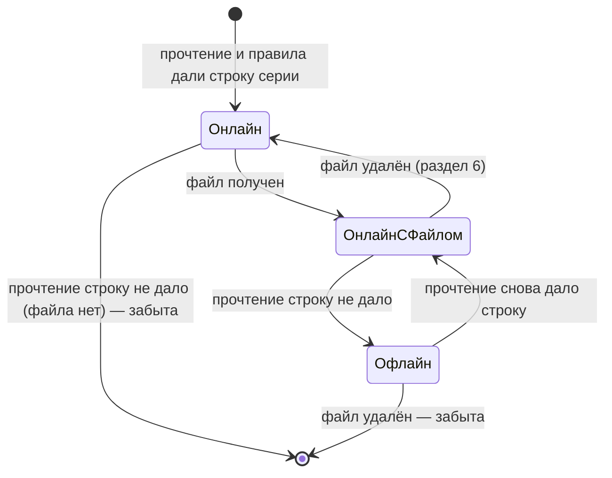

# Таблица серии: онлайн и офлайн — модель

Дата: 2026-11-08. Состояние: проект модели этапа 12 (расширение), к согласованию; кода нет. Требования дословно —
[СЛОВА_ВЛАДЕЛЬЦА.md](СЛОВА_ВЛАДЕЛЬЦА.md).

## 1. Суть

Источники непостоянны: канал удаляет старые серии, перезаливает их компиляцией, меняет ссылки. То, что система уже
получила (скачанное видео, выровненная озвучка, видео, вырезанное из компиляции), — актив. Он не зависит от того, есть
ли его строка в источнике сейчас.

У каждой серии своя таблица строк. Строки источника попадают в неё не напрямую, а через правила конструктора: правило
решает, какой серии строка принадлежит и что ей назначено. Каждая строка таблицы серии отвечает на один вопрос:
**онлайн** она (источник отдаёт её сейчас) или **офлайн** (источник её больше не отдаёт, но за ней есть файл). Строка
без файла, пропавшая из источника, забывается. Строка с файлом живёт, пока жив файл, и участвует во всём наравне с
онлайн-строками.

Отключение ничего не удаляет: оно прячет файл от медиасервера. Удаляет только явная кнопка «Удалить» и замена видео
лучшим.

## 2. Термины

| Термин | Значение |
|---|---|
| Таблица источника | Строки одной страницы сайта или одного канала, одна таблица на источник. Плеер — поле строки: одна строка — одно видео одного плеера |
| Таблица серии | Строки, которые правила конструктора отнесли к этой серии, и строки с файлами, которые были её раньше |
| Строка серии | Видео или озвучка серии из одного источника и одного плеера, с тем, что назначили правила (сезон, серия, часть, группа озвучки) |
| Онлайн | Последнее полное и успешное прочтение источника принесло эту строку, и правила отнесли её к этой серии |
| Офлайн | Строка с файлом, которую последнее полное и успешное прочтение этой серии не дало |
| Файл строки | Видео в библиотеке, дорожка озвучки в контейнере серии, видео, вырезанное из компиляции, извлечённая дорожка отключённой озвучки |
| Слепок | Происхождение файла, записанное в момент его получения: источник (сайт, канал или страница, название), плеер, группа озвучки и имя озвучки, как пришло, разрешение, ссылка, видео по счёту хоста |
| Отключено | Пользователь отключил серию, строку, плеер, озвучку или сезон: новой работы нет, файлы лежат в формате, который медиасервер не читает |
| Удалить | Явная команда пользователя: следующая синхронизация удаляет файл или дорожку строки |

## 3. Строка серии

| Часть | Поля | Меняется |
|---|---|---|
| Тождество | источник, ключ строки в таблице источника, видео по счёту хоста | никогда: другое значение — другая строка |
| Назначено правилами | сезон, серия, часть, группа озвучки | при каждом прочтении, пока строка онлайн |
| Сейчас в источнике | ссылка, разрешения, доступность, название | при каждом прочтении, пока строка онлайн |
| Состояние | онлайн, офлайн; включена, отключена | по прочтению источника (раздел 4) и по слову пользователя (раздел 6) |
| Файл | путь видео или ключ дорожки в контейнере, путь извлечённой дорожки, ревизия файла | при получении, отключении, включении и замене файла |
| Слепок файла | происхождение файла (раздел 2) | пишется один раз, при получении файла |
| Выравнивание (озвучка) | по какому видео выровнена дорожка: тождество строки референса и ревизия его файла | при каждом выравнивании |
| Родители (видео из компиляции) | слепок строки компиляции и слепок строки РЕФ 2, по которой резали; секунды из компиляции и из серии | пишется один раз, при приёме видео |

Слепок файла и «сейчас в источнике» — разные вещи. Источник может начать отдавать 1080p вместо 720p, а файл
остаётся тем, что скачано. Окно показывает оба.

## 4. Онлайн и офлайн

| Правило | Содержание |
|---|---|
| С-1 | Онлайн и офлайн решает только **полное и успешное** прочтение источника. Сбой сайта, прочтение не до конца, видео, которое канал скрыл из списка, состояние строки не меняют |
| С-2 | Строка без файла существует только онлайн |
| С-3 | Строка с файлом не забывается ни по какой причине, кроме удаления (раздел 6) |
| С-4 | Удалён источник или его профиль — все его строки с файлами становятся офлайн, строки без файлов забываются |

## 5. Участие офлайн-строки

Офлайн-строка — полноправный участник. Она стоит во всех таблицах окна (источники, очередь «РЕФ», озвучки, вкладки
раскрытой серии) с отметкой «офлайн» и слепком источника.

| Роль | Как участвует |
|---|---|
| Референс | Остаётся референсом, пока его не заменит лучший (Д-2, Д-3) или пока его не удалят (Д-1) |
| Озвучка | Её дорожка остаётся в контейнере. При смене референса она **перевыравнивается из прежнего контейнера** (раздел 7) |
| Видео из компиляции | Остаётся референсом своей серии, когда компиляция или РЕФ 2 пропали из источника |
| Кандидат в новую работу | Новой загрузки по офлайн-строке нет: ссылки, которую можно скачать, нет |

## 6. Отключение и удаление

### Отключение ничего не удаляет

| № | Что отключено | Что делает синхронизация |
|---|---|---|
| О-1 | Серия, сезон, источник, профиль, плеер; строка, исключённая правилом | Новой работы нет. Видео и контейнер серии остаются на месте в формате, который медиасервер не читает |
| О-2 | Отдельная озвучка серии (дорожка) | Дорожка извлекается из контейнера в аудиофайл рядом с ним, в формате, который медиасервер не читает, и убирается из контейнера |
| О-3 | Включено обратно | Файл возвращается в рабочий формат, дорожка — в контейнер. Загрузки и выравнивания нет, если референс серии за это время не сменился |

### Удаление — полный перечень

| № | Причина | Что уходит |
|---|---|---|
| Д-1 | Пользователь нажал «Удалить» у строки, и синхронизация прошла. Кнопка есть только у строки, у которой фактически есть файл или дорожка в контейнере | Файл или дорожка строки; офлайн-строка забывается |
| Д-2 | Вышел более подходящий референс: новое видео скачано, все озвучки перевыровнены по нему, контейнер собран | Прежнее видео. Его строка: онлайн — остаётся без файла, офлайн — забывается |
| Д-3 | Обновилась компиляция или РЕФ 2: выше разрешение, приоритетнее источник, подходящая озвучка, РЕФ 2 сменён пользователем — и синхронизация прошла; новое видео вырезано, озвучки перевыровнены, контейнер собран | Прежнее видео из компиляции, как в Д-2 |

Больше ничто файлов не удаляет:
- пропажа строки из источника;
- сбой или неполное прочтение;
- удаление источника или профиля;
- изменение правил разбора;
- смена или снятие группы озвучки;
- смена ключа или диапазона компиляции;
- любое отключение.

### Удаление референса

| № | Правило |
|---|---|
| Д-4 | «Удалить» у референса: синхронизация сначала извлекает в отдельные файлы все **офлайн**-дорожки контейнера. Онлайн-дорожки не извлекаются: с новым референсом им всё равно нужно выравнивание из свежей загрузки |
| Д-5 | Исключение из Д-4: новый референс — тот же источник и плеер в большем разрешении. Это то же видео (то же тождество), дорожки годны без выравнивания: контейнер перепаковывается с новым видео |

## 7. Замена видео серии и перевыравнивание

| Правило | Содержание |
|---|---|
| З-1 | Замена видео серии (Д-2, Д-3) атомарна: прежний контейнер живёт, пока не собран новый, в котором есть все участники прежнего |
| З-2 | Источник перевыравнивания офлайн-озвучки — прежний контейнер. Он подаётся сервису выравнивания как озвучка с номером дорожки (`dub_atracks`): картинка прежнего видео и дорожка, синхронная с ней. Звук в контейнере без потерь |
| З-3 | Онлайн-озвучка перевыравнивается из свежей загрузки, как сейчас |
| З-4 | Вставки звука прежнего референса в паузах озвучки (сервис заполняет паузы звуком референса) переходят вместе с дорожкой; где в новом референсе этой части нет, они уходят. Это принятая жертва: тишину оставлять нельзя |
| З-5 | Если перевыравнивание хоть одной озвучки не удалось, замена не выполняется: серия остаётся на прежнем контейнере, в окне ошибка с выбором «Повторить» или «Удалить эту озвучку» (Д-1) |

## 8. Слепок в самом файле

| Правило | Содержание |
|---|---|
| Ф-1 | Каждый контейнер MKV несёт вложение `provenance.json` (тип `application/json`): строки серии, которые в нём лежат, со слепками, выравниванием и родителями |
| Ф-2 | Вложение пишет сборка контейнера при каждой сборке. Сейчас сборка сбрасывает все метки и не переносит вложения (`core/container.py`, `-map_metadata -1`) |
| Ф-3 | База — рабочий указатель, файл — резерв. Таблицу серии можно восстановить из вложений её контейнеров («усыновление»), и сверка базы с файлами — штатная проверка |
| Ф-4 | Видео, ещё не собранное в контейнер (`.mp4` как скачано), вложения не держит: его слепок до первой сборки живёт только в базе |
| Ф-5 | Извлечённая дорожка (О-2, Д-4) хранит свой слепок и выравнивание так же: в метках аудиофайла |

Проверено на ffmpeg сервера: вложение JSON пишется, читается обратно байт в байт и переживает перепаковку с
сохранением всех потоков. Правка вложения без перезаписи файла требует `mkvpropedit` (mkvtoolnix), на сервере его нет.

## 9. Инварианты

| № | Инвариант |
|---|---|
| И-1 | Строка без файла — только онлайн (С-2) |
| И-2 | Файл уходит только по Д-1…Д-3; отключение файла не удаляет |
| И-3 | Каждая дорожка контейнера — ровно одна строка серии; каждая включённая строка-озвучка с файлом — ровно одна дорожка; каждая отключённая — ровно один извлечённый файл |
| И-4 | Дорожка выровнена по видео своего контейнера (тождество и ревизия); иначе её перевыравнивают до сборки |
| И-5 | Слепок файла не меняется после получения файла |
| И-6 | Вложение контейнера совпадает с записью строк серии в базе |
| И-7 | Прежний контейнер не удаляется, пока новый не собран со всеми участниками (З-1) |
| И-8 | Файл отключённой строки медиасервер не читает; файл включённой — читает |

## 10. Противоречия с действующими решениями

| № | Что | Решение модели |
|---|---|---|
| П-1 | Д-48 (этап 10): снятая галочка, удалённый источник или профиль, исключение строки → файл убирается (`scan/module.py` `_removed_by_configuration`, `downloads/library.py` `remove_unwanted`) | Отменяется: отключение файлов не удаляет (О-1…О-3), удаление — только Д-1…Д-3 |
| П-2 | Р-77: озвучка без группы не в работу. Код при этом удаляет и уже выложенные дорожки такой озвучки (`voices/repository.py` `drop_unplanned`) | Готовые дорожки остаются строками серии; правило касается только новой работы |
| П-3 | Озвучка, исчезнувшая из сезона целиком (источник убран, канал удалил видео), уходит из плана, и синхронизация удаляет её дорожки (`drop_unplanned`) | Озвучка становится офлайн-строкой, дорожка остаётся |
| П-4 | Этап 12: видео из компиляции опознаётся ключом из группы, источника, плеера и диапазона. Сменилась любая часть — серия режется заново | Видео из компиляции — строка серии со слепками родителей; новый разбор только по Д-3 |
| П-5 | Удержание референса держится на прошлой записи выбора и только пока источник числится в сериале (`scan/reference.py`) | Удержание — следствие модели: офлайн-строка с файлом остаётся референсом (раздел 5) |
| П-6 | Окно строит источники и очереди только из строк раскладки (Д-72) | Окно строит их из таблицы серии: онлайн-строки — как сейчас, офлайн — со слепком |

## 11. Решено владельцем

| № | Вопрос | Решение |
|---|---|---|
| В-2 | Исключение правилом, выключенный плеер, сезон, серия — удаление или нет | Отключение не удаляет: файлы в формате, который медиасервер не читает; отключённая дорожка — отдельным аудиофайлом рядом. Удаление — отдельная кнопка, только при фактическом файле (раздел 6) |
| В-3 | Вставки звука прежнего референса при перевыравнивании из контейнера | Не проблема: вставка уходит, если в новом референсе этой части нет; принятая жертва (З-4) |
| В-4 | Звук видео из компиляции — смесь компиляции и краёв РЕФ 2 | Допустимая жертва |
| В-5 | Удаление офлайн-референса | Сначала извлекаются офлайн-дорожки; онлайн — нет; кроме того же источника и плеера в большем разрешении (Д-4, Д-5) |
| В-7 | Торренты | Вне модели; позже |
| В-8 | Место в дорожной карте | Этап 12, расширение |

## 12. Открытые вопросы

| № | Вопрос | Факт | Предложение |
|---|---|---|---|
| В-1 | Правило перенумеровало строку: видео, которое лежит файлом серии 5, теперь читается как серия 6 | Сейчас запись строки получает новый номер, и референс серии 5 уходит вслед за строкой | Видео следует за строкой в серию 6 (это то же видео, а перенумерация обычно — исправление правила). Дорожки озвучек серии 5, выровненные по нему, извлекаются и остаются у серии 5 офлайн-строками до её нового референса |
| В-6 | Сайт оставил строку («Серия 5», тот же ключ строки, те же правила), но подменил видео за ссылкой: перезалил в лучшем качестве или с другим монтажом | Правила конструктора отработают так же, текст строки тот же | Тождество строки включает видео по счёту хоста: новое видео — новая онлайн-строка; прежний файл — офлайн-строка прежнего видео |
| Н-1 | Каким сделать формат, который медиасервер не читает | — | Видео и контейнер — суффикс к имени (`… .mkv.off`); дорожка — FLAC с тем же суффиксом. Перед кодом проверить на вашем Jellyfin, что такие файлы не попадают в библиотеку |
| Н-2 | Включение озвучки обратно (О-3), когда референс за это время сменился: у извлечённой дорожки нет картинки, а сервис выравнивания ведёт озвучку по её картинке | Документация сервиса: картинка озвучки направляет выравнивание; выравнивание только по звуку не описано | Нужно ваше знание сервиса: выравнивает ли он озвучку без видео. Если нет — извлечённая дорожка хранится вместе с видео, к которому выровнена (короткий MKV: видео прежнего референса + дорожка), а не голым аудио |
| Н-3 | «Удалить» у **онлайн**-строки с файлом: если строка остаётся включённой, следующая синхронизация скачает её снова | — | «Удалить» у онлайн-строки удаляет файл и отключает строку; включение обратно — новая загрузка |
