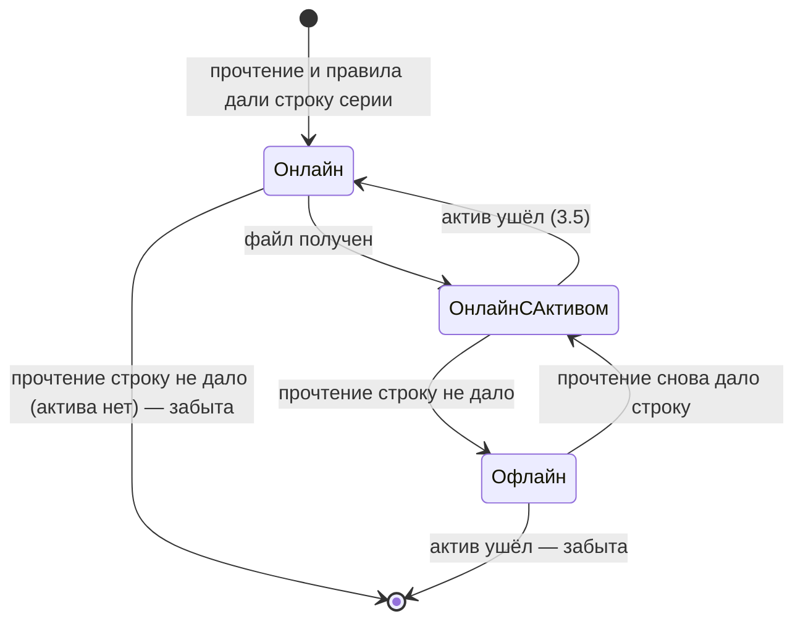

# Таблица серии: онлайн и офлайн — модель

Дата: 2026-11-08. Состояние: проект модели этапа 12 (расширение), к согласованию; работает симулятор
([SIMULATOR.md](SIMULATOR.md)), действующая система ещё не переведена. Требования дословно — [СЛОВА_ВЛАДЕЛЬЦА.md](СЛОВА_ВЛАДЕЛЬЦА.md).

## 1. Суть

Источники непостоянны: канал удаляет старые серии, перезаливает их компиляцией, меняет ссылки. То, что система уже
получила (скачанное видео, выровненная озвучка, видео, вырезанное из компиляции), — **актив**. Он не зависит от того,
есть ли его строка в источнике сейчас.

Работой управляет один **планировщик**. На входе у него только таблицы и приоритеты: что отдают источники сейчас
(после правил конструктора), что лежит в активе и как получено, что выбрал пользователь. Из них он выводит **цель** —
каким должен быть каждый контейнер, — и строит **граф операций** от того, что есть, к цели. Отдельной логики под
ситуацию (перенумерация, смена референса, пропажа источника, удаление) нет: всякая ситуация — это просто другие входы.

Отключение ничего не удаляет: оно прячет файл от медиасервера. Актив уходит только тогда, когда его содержание
перенесено в цель, или по явной кнопке «Удалить». Переименования и удаления применяются только после того, как
выполнены все преобразования.

## 2. Термины

| Термин | Значение |
|---|---|
| Таблица источника | Строки одной страницы сайта или одного канала, одна таблица на источник. Плеер — поле строки: одна строка — одно видео одного плеера |
| Онлайн-таблица серии | Строки источников, которые правила конструктора отнесли к этой серии при последнем полном и успешном прочтении |
| Таблица актива | Что лежит на диске и как получено: видео, вырезанные видео, контейнеры и их дорожки — со слепками, выравниванием и родителями |
| Строка серии | Видео или озвучка серии из одного источника и одного плеера: онлайн-строка, строка актива или обе сразу |
| Онлайн / офлайн | Онлайн — строка есть в онлайн-таблице серии. Офлайн — её там нет, но за ней есть актив |
| Слепок | Происхождение файла, записанное в момент его получения: источник (сайт, канал или страница, название), плеер, группа озвучки и имя озвучки, как пришло, разрешение, ссылка, видео по счёту хоста |
| Приоритеты и выбор | Порядок плееров и источников, очереди «РЕФ» и озвучек, включено и отключено, участие в компиляции, команда «Удалить» |
| Цель | Каким должен быть контейнер каждой серии: какое видео, какие дорожки, в каком порядке, под каким именем, включён или отключён |
| Операция | Шаг графа: скачать, вырезать из компиляции, выровнять, собрать контейнер, переименовать или переместить, отключить (`.off`), включить, удалить |

## 3. Планировщик

### 3.1. Входы — только таблицы и приоритеты

| Вход | Откуда |
|---|---|
| Онлайн-таблицы серий | Прочтения источников, пропущенные через правила конструктора |
| Таблица актива | База и, как резерв, вложения самих контейнеров (раздел 8) |
| Приоритеты и выбор пользователя | Настройки и рычаги серии, сезона, компиляции, сериала |

Больше планировщик ничего не читает и ничего не помнит между прогонами, кроме этих таблиц.

### 3.2. Цель — функция входов

Для каждой серии:

| Часть цели | Как выводится |
|---|---|
| Видео (референс) | Первое по приоритетам из строк серии, где есть видео: онлайн-строки, видео актива этой серии, видео, которое можно вырезать из компиляции |
| Озвучки | Строки серии включённых групп: онлайн-строки и строки актива с дорожкой. Номер серии озвучки — номер её собственной строки |
| Дорожка каждой озвучки | Выровнена по видео цели (тождество строки видео) |
| Имя и порядок | По правилам имени и порядку озвучек сезона |
| Включён ли | Отключённая серия — контейнер с суффиксом `.off` |

Строка актива числится в серии по номеру своей строки: онлайн — по нынешнему номеру от правил, офлайн — по последнему
номеру, который у неё был.

### 3.3. Как достигается каждая часть цели — одно правило на всё

Для каждой части цели планировщик берёт **первый доступный путь** из одного и того же списка:

| Часть цели | Пути по порядку |
|---|---|
| Видео серии | 1) актив уже держит это видео (то же тождество, не ниже по разрешению) — взять как есть; 2) строка онлайн — скачать; 3) видео из компиляции — скачать компиляцию и вырезать. Вырезанное видео ниже нынешней компиляции — кандидат на новый разбор, как та же строка в большем разрешении. Из нескольких файлов одного видео его представляет лучший: выше разрешением, затем файл серии, затем не отключённый |
| Дорожка озвучки D к видео R | 1) в активе есть дорожка D, выровненная по R, — взять как есть; 2) строка D онлайн — скачать и выровнять по R; 3) строка D офлайн, в активе есть её дорожка при другом видео — выровнять по R **из того контейнера**: он подаётся сервису выравнивания как озвучка с номером дорожки (`dub_atracks`), картинка и звук синхронны |
| Свой звук прежнего видео | Свой звук видео — тоже актив: озвучка строки, из которой видео (у вырезанного — озвучка компиляции). Когда видео серии сменилось, он становится дорожкой нового контейнера теми же путями 1 и 3 (из прежнего контейнера по номеру дорожки) |
| Имя, место, порядок | Переименовать или переместить; пересобрать контейнер, если меняется состав или порядок дорожек. Имя даёт правило имени сериала |

Операции связаны зависимостями: загрузка → вырезание или выравнивание → сборка контейнера → применение. Это и есть
граф.

### 3.4. Срез и синхронизация

То, что лежит на диске, — **срез**. Между синхронизациями на диске не меняется ничего: меняются только таблицы (прочтения
источников, правила, выбор пользователя), и планировщик пересчитывает план от среза и этих изменений.

| Шаг | Что происходит |
|---|---|
| Запуск синхронизации | Берётся последний план; с этого момента входы заморожены, изменений нет до конца |
| Преобразование | Загрузки, вырезания, выравнивания, сборка новых контейнеров рядом с прежними. Ни один файл среза не трогается: он может быть источником выравнивания (путь 3) |
| Перепланирование | Неудачная попытка записывается (3.7), и план пересчитывается **от того же среза** с этой записью: планировщик берёт следующий путь. Так до тех пор, пока новых неудач нет |
| Применение | Один раз, в конце: переименования, перемещения, `.off`, удаление того, что заменено, команды «Удалить». Получается срез 2 |

Срез 1 цел, пока не готов срез 2. Серии, которые делят файлы (берут из одного файла или пишут туда, где лежит файл другой
серии), применяются вместе.

### 3.5. Что уходит из актива

| Случай | Что с активом |
|---|---|
| Цель использует его (путь 1) | Остаётся, при необходимости переименовывается или переезжает |
| Его содержание в цели получено заново (путь 2 или 3: новая загрузка, новое выравнивание, лучшее видео) | Удаляется в фазе применения |
| Цель его не использует и он ничем не заменён (нет видео, к которому его выровнять) | Остаётся скрытым под своим именем `… .hidden-N.mkv.off`: оно не совпадает с именем отключённой серии. Офлайн-строка при нём сохраняется |
| Его озвучка в цели — свой звук нового видео | Заменён: удаляется в фазе применения |
| Пользователь нажал «Удалить» | Удаляется в фазе применения |

### 3.6. Ситуации как следствия — пример

Серия 5: референс и 20 выровненных озвучек. Правило перенумеровало референс и три озвучки в серию 6, остальные 17
остались серией 5; у одной из 17 нет онлайн-строки.

| Цель | Путь | Операции |
|---|---|---|
| Серия 6: видео | 1 — актив держит это видео | — |
| Серия 6: три озвучки | 1 — их дорожки выровнены по этому видео | — |
| Серия 6: другие озвучки серии 6 | 2 — скачать и выровнять по видео | загрузка, выравнивание |
| Серия 5: видео | по приоритетам из строк серии 5 | загрузка |
| Серия 5: 16 онлайн-озвучек | 2 — скачать и выровнять по новому видео | загрузка, выравнивание |
| Серия 5: офлайн-озвучка | 3 — выровнять из прежнего контейнера | выравнивание |
| Применение | после всех операций | сборка двух контейнеров; прежний контейнер уходит (его видео и три дорожки — в контейнере серии 6, 17 дорожек заменены); имена |

Другие ситуации раскладываются так же:

| Ситуация | Что меняется во входах | Что выходит |
|---|---|---|
| Источник удалил видео | строка ушла из онлайн-таблицы | цель та же, путь 1 — ничего не делается |
| Вышел лучший референс | новая онлайн-строка выше по приоритету | путь 2 для видео, дорожки — путь 2 или 3, применение заменяет прежнее |
| Тот же источник и плеер в большем разрешении | у той же строки выше разрешение | путь 2 для видео; дорожки — путь 1 (то же тождество), только пересборка |
| «Удалить» у референса | команда во входах | цель берёт следующее видео; дорожки — путь 2 или 3; применение удаляет прежнее |
| Отключили серию | выбор пользователя | цель — контейнер `.off`; применение переименовывает |
| Сменилась группа озвучки компиляции | правило дало другую группу | вырезанное видео — актив, путь 1; новый разбор только если цель выбирает другое видео |

### 3.7. Неудачи — записи, которые планировщик обходит

| Запись | Что значит | Что делает планировщик |
|---|---|---|
| Не скачалась строка | загрузка видео, озвучки или компиляции не удалась | берёт следующий источник или плеер |
| Не выровнялась озвучка к видео | пара «эта озвучка — это видео» | берёт другую строку той же озвучки или выравнивание из прежнего контейнера; к **другому** видео эта озвучка пробуется заново |
| Не вырезалась серия из компиляции | пара «эта компиляция — эта одиночная серия» | берёт другое видео серии |

Неудача сама по себе ничего не блокирует. Озвучка, для которой не нашлось пути, не попадает в новый контейнер, и окно
показывает неудачу. Актив при этом не теряется: дорожка, которую нечем заменить, остаётся в прежнем файле, скрытом (3.5).
Записи действуют, пока пользователь их не сбросит; запись о выравнивании к видео, которого больше нет в цели, ни на что
не влияет.

## 4. Строка серии

| Часть | Поля | Меняется |
|---|---|---|
| Тождество | источник, ключ строки в таблице источника, видео по счёту хоста | никогда: другое значение — другая строка |
| Назначено правилами | сезон, серия, часть, группа озвучки | при каждом прочтении, пока строка онлайн |
| Сейчас в источнике | ссылка, разрешения, доступность, название | при каждом прочтении, пока строка онлайн |
| Состояние | онлайн, офлайн; включена, отключена | по прочтению источника (раздел 5) и по выбору пользователя |
| Файл | путь видео или ключ дорожки в контейнере, ревизия файла | в фазе применения |
| Слепок файла | происхождение файла (раздел 2) | пишется один раз, при получении файла |
| Выравнивание (озвучка) | по какому видео выровнена дорожка: тождество строки видео и ревизия его файла | при каждом выравнивании |
| Родители (видео из компиляции) | слепок строки компиляции и слепок строки РЕФ 2, по которой резали; секунды из компиляции и из серии | пишется один раз, при приёме видео |

Слепок файла и «сейчас в источнике» — разные вещи. Источник может начать отдавать 1080p вместо 720p, а файл
остаётся тем, что скачано. Окно показывает оба.

## 5. Онлайн и офлайн

| Правило | Содержание |
|---|---|
| С-1 | Онлайн и офлайн решает только **полное и успешное** прочтение источника. Сбой сайта, прочтение не до конца, видео, которое канал скрыл из списка, состояние строки не меняют |
| С-2 | Строка без актива существует только онлайн |
| С-3 | Удалён источник или его профиль — его строки с активом становятся офлайн, строки без актива забываются |

Офлайн-строка — полноправный участник: она стоит во всех таблицах окна (источники, очередь «РЕФ», озвучки, вкладки
раскрытой серии) с отметкой «офлайн» и слепком источника. Новой загрузки по ней нет: ссылки, которую можно скачать,
нет.

## 6. Отключение и удаление

| № | Что | Что делает применение |
|---|---|---|
| О-1 | Отключены серия, сезон, источник, профиль, плеер; строка исключена правилом | Новой работы нет. Видео и контейнер остаются на месте с суффиксом `.off` (`… .mkv.off`): медиасервер их не читает. Дорожки остаются внутри, при своём видео |
| О-2 | Отключена озвучка, у которой **ещё нет** дорожки в контейнере | Работа по ней не начинается, начатое убирается |
| О-3 | Озвучка, у которой дорожка **уже в контейнере** | Отключить нельзя, только удалить. Дорожка намертво привязана к своему видео: отдельно от него она — мёртвый груз. Это касается и звука видео из компиляции |
| О-4 | Включено обратно | Суффикс `.off` снимается. Загрузки и выравнивания нет |
| Д-1 | «Удалить» — есть только у строки, у которой фактически есть файл или дорожка в контейнере | Файл или дорожка уходит в фазе применения; офлайн-строка забывается. Онлайн-строка, оставшаяся включённой, при следующей синхронизации скачивается заново: «Удалить» не отключает |

Отключение озвучки на уровне сезона или сериала (рычаг группы, вариант, Р-77) действует по О-2 и О-3.

Вставки звука прежнего видео в паузах озвучки (сервис выравнивания заполняет паузы звуком видео) переходят при
выравнивании из контейнера вместе с дорожкой; где в новом видео этой части нет, они уходят. Это принятая жертва:
тишину оставлять нельзя.

## 7. Слепок в самом файле

| Правило | Содержание |
|---|---|
| Ф-1 | Каждый контейнер MKV несёт вложение `provenance.json` (тип `application/json`): строки серии, которые в нём лежат, со слепками, выравниванием и родителями |
| Ф-2 | Вложение пишет сборка контейнера при каждой сборке. Сейчас сборка сбрасывает все метки и не переносит вложения (`core/container.py`, `-map_metadata -1`) |
| Ф-3 | База — рабочий указатель, файл — резерв. Таблицу актива можно восстановить из вложений контейнеров («усыновление»); сверка базы с файлами — штатная проверка |
| Ф-4 | Видео, ещё не собранное в контейнер (`.mp4` как скачано), вложения не держит: его слепок до первой сборки живёт только в базе |
| Ф-5 | Отключённый контейнер (`.mkv.off`) несёт то же вложение |

Проверено на ffmpeg сервера: вложение JSON пишется, читается обратно байт в байт и переживает перепаковку с
сохранением всех потоков. Правка вложения без перезаписи файла требует `mkvpropedit` (mkvtoolnix), на сервере его нет.

## 8. Инварианты

| № | Инвариант |
|---|---|
| И-1 | Цель и граф — функция входов (таблицы и приоритеты): одинаковые входы — одинаковый план. Правил под отдельную ситуацию нет; проверка — перебором сочетаний входов |
| И-2 | Строка без актива — только онлайн |
| И-3 | Актив уходит только по 3.5: содержание перенесено в цель или «Удалить». Отключение не удаляет |
| И-4 | Применение — один раз, в конце синхронизации; срез 1 цел до готовности среза 2; прежний файл живёт, пока он нужен как источник |
| И-5 | Каждая дорожка контейнера — ровно одна строка серии; каждая строка-озвучка с активом — ровно одна дорожка. Дорожки вне контейнера не бывает |
| И-6 | Дорожка выровнена по видео своего контейнера (тождество и ревизия) |
| И-7 | Слепок файла не меняется после получения файла |
| И-8 | Вложение контейнера совпадает с записью актива в базе |
| И-9 | Файл отключённой строки медиасервер не читает; файл включённой — читает |

## 9. Противоречия с действующим устройством

| № | Как сейчас | По модели |
|---|---|---|
| П-1 | План разнесён по модулям, и в каждом свои правила под ситуации: удержание референса (`scan/reference.py`), «видео отдано другой серии», «варианты оставлены», «вышла из плана», «серия без референса» (`voices/module.py`, `voices/repository.py`), «снято настройкой», «вытеснено победителем», остатки сборки (`downloads/library.py`, `downloads/packing.py`), ключ и снятие разбора (`voices/cuts.py`) | Один планировщик: цель из таблиц и приоритетов, граф от цели; модули — исполнители операций |
| П-2 | Д-48 (этап 10): снятая галочка, удалённый источник или профиль, исключение строки → файл убирается (`scan/module.py` `_removed_by_configuration`, `downloads/library.py` `remove_unwanted`) | Отменяется: отключение не удаляет (раздел 6), актив уходит только по 3.5 |
| П-3 | Р-77 и пропажа озвучки из сезона: уже выложенные дорожки удаляются (`voices/repository.py` `drop_unplanned`) | Дорожка остаётся строкой актива (3.5, третья строка) |
| П-4 | Видео из компиляции опознаётся ключом из группы, источника, плеера и диапазона; сменилась любая часть — серия режется заново | Вырезанное видео — актив со слепками родителей; новый разбор — только если цель выбирает другое видео |
| П-5 | Окно строит источники и очереди только из строк раскладки (Д-72) | Окно строит их из таблицы серии: онлайн-строки — как сейчас, офлайн — со слепком |
| П-6 | Прежний контейнер уходит при сборке нового; дорожка, чьё перевыравнивание не удалось, теряется | Применение — в конце синхронизации (И-4); дорожка без пути остаётся в прежнем файле (3.7) |

## 10. Решено владельцем

| № | Вопрос | Решение |
|---|---|---|
| В-1 | Правило перенумеровало строки | Номер даёт правило; дальше — общий планировщик (3.6). Причин две. Референс оказался другой серией (почти все озвучки не выравниваются): правило исправляют, видео уходит в свою серию и соревнуется там по приоритету, прежнее видео той серии лежит, пока не готов новый контейнер с полным набором озвучек; серия, откуда видео ушло, выбирает видео заново и идёт обычным путём; неудачи против неверного видео больше не действуют. Серию перенумеровали сознательно: файл переезжает с дорожками как есть, выравнивается только то, что не совпало. Перенумерованное видео, проигравшее по приоритету, уходит как заменённое, когда его офлайн-дорожки получили место в плане |
| В-2 | Исключение правилом, выключенный плеер, сезон, серия | Отключение не удаляет: суффикс `.off`. Удаление — отдельная кнопка, только при фактическом файле |
| В-3 | Вставки звука прежнего видео при выравнивании из контейнера | Принятая жертва (раздел 6) |
| В-4 | Звук видео из компиляции — смесь компиляции и краёв РЕФ 2 | Допустимая жертва |
| В-5 | Удаление офлайн-референса | Офлайн-дорожки сохраняются выравниванием из прежнего контейнера, онлайн — заново; тот же источник и плеер в большем разрешении — без выравнивания (3.6) |
| В-7 | Торренты | Вне модели; позже |
| В-8 | Место в дорожной карте | Этап 12, расширение |
| Н-1 | Формат, который медиасервер не читает | Суффикс `.off` |
| Н-2 | Отдельная дорожка без видео | Не бывает; в контейнере — только удалить (О-3) |
| Н-3 | «Удалить» у онлайн-строки | Удаляет файл; включённая строка скачивается снова |
| — | Как планировать | Процедурно: на входе только таблицы и приоритеты, цель выводится из них, граф строится от цели; заранее выделенной логики для ситуации нет |

## 11. Открытые вопросы

| № | Вопрос | Предложение |
|---|---|---|
| В-6 | Сайт оставил строку («Серия 5», тот же ключ строки, те же правила), но подменил видео за ссылкой: перезалил в лучшем качестве или с другим монтажом | Тождество строки включает видео по счёту хоста: новое видео — новая онлайн-строка; прежний файл — офлайн-строка прежнего видео |
| В-9 | «Удалить» у референса, а другого видео у серии нет: дорожкам не к чему выравниваться, отдельно они не живут | Окно до применения говорит «другого видео нет — вместе с референсом уйдут озвучки: …» и ждёт подтверждения |
| В-10 | Отключение группы озвучки на сезон или сериал, когда у части серий её дорожки уже в контейнерах | Рычаг останавливает новую работу; у серий с дорожкой окно показывает «дорожка в контейнере — только удалить» и кнопку «Удалить» |
