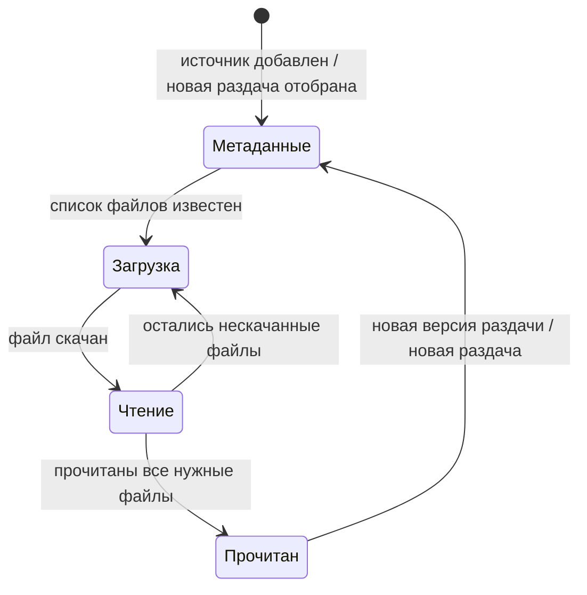

# Этап 15 — источник торрент: устройство

Состояние: к согласованию, 2026-11-09. ТЗ дословно — [ЭТАП_15.md](ЭТАП_15.md).

Торрент становится обычным источником сериала: тот же путь «сайт → таблица строк → конструктор правил → планировщик»,
что у VK и сайтов. Истина о раздаче — скачанный файл; строка конструктора — одна дорожка файла.

## 1. Термины

| Термин | Значение |
|---|---|
| Раздача | один торрент (infohash): то, что даёт страница трекера или результат поиска |
| Промежуточный каталог | место загрузки раздач источника под исходными именами файлов; вне медиатеки; итоговый файл серии из него собирает планировщик |
| Карта файла | что лежит в файле раздачи по чтению ffprobe: видео (высота, длительность) и каждая дорожка (номер, язык, тег названия, кодек, каналы, флаги) |
| Строка дорожки | строка таблицы источника: одна звуковая дорожка одного файла; все строки файла несут одну идентичность видео |
| Свой звук видео | звук, синхронный видео без выравнивания; у файла раздачи это все его звуковые дорожки и внешние звуковые файлы, отнесённые к нему |

## 2. Три вида торрент-источников

| Вид | Пример | Страница | Где обновление | Часть таблицы |
|---|---|---|---|---|
| Раздача | kinozal, rutracker | одна раздача | внутри раздачи: новый infohash, новые файлы | раздача; новая версия заменяет прежнюю |
| Каталог раздач тайтла | anistar | список раздач (серия, несколько серий, пак) | новые раздачи на странице | каждая раздача |
| Поиск | nyaa | `сайт \| запрос`, как канал VK | новые результаты поиска | каждая отобранная раздача |

Все три — сайты общего протокола `Site` (`modules/sources/sites`), таблица читается `TableReader`. Разница повторного
чтения — строки появились, пропали, сменили версию — для планировщика одна. Несколько раздач на одну серию (пак и
одиночные, разные раздающие) — несколько кандидатов серии, их выбирают те же рычаги, что выбирают между плеерами; из
выбранной раздачи качаются только нужные файлы (приоритеты qBit).

## 3. Отбор кандидатов

Правила конструктора работают на двух уровнях:

| Уровень | Поля | Когда |
|---|---|---|
| Раздача | заголовок, раздающий, разрешение в заголовке, размер, дата, сиды | до загрузки: в промежуточный каталог идут только отобранные раздачи |
| Дорожка | поля раздела 5 | после чтения файла |

Для видов «каталог» и «поиск» отбор по раздаче обязателен: загрузка ради чтения всех результатов недопустима.
`.torrent` и карта файла неизменны при неизменном infohash и хранятся без срока; лимит скачиваний `.torrent` трекера
(kinozal) — ограничение отбора.

## 4. Жизнь источника

- Добавление источника = добавление раздачи в промежуточный каталог и её загрузка; источник просканирован, когда прочитаны
  все его нужные файлы.
- Файл читается, как только скачан он сам; строки появляются пофайлово. Прогресс загрузки и чтения — событиями модуля.
- Нужные файлы: видео серий, кроме исключённых сезонов и серий (по имени файла, до загрузки), и все внешние звуковые
  файлы и субтитры раздачи.
- Новая версия раздачи кладётся в тот же промежуточный каталог под теми же исходными именами; qBit засчитывает
  совпавшее, перечитываются только изменившиеся файлы.
- Часть таблицы, которую прочитать не удалось (`.torrent` не получен, файл не скачан), — непрочитанная часть
  (`ReleaseTable.unread`): строки, данные ею прежде, сохраняются.

## 5. Расшифровка: файл → строки

Чистая функция: карта файла → строки таблицы.

| Поле строки | Откуда |
|---|---|
| ключ | раздача + путь файла + номер дорожки |
| `video` | идентичность видеофайла: одна у всех строк файла и отнесённых к нему внешних файлов |
| высота кадра | видео файла |
| вид (`RowVoice.kind`) | озвучка, оригинал, субтитры |
| название озвучки | пусто; даёт конструктор («Неизвестная озвучка N» вне групп, требование 15 CHARTER) |
| поля для правил | номер дорожки, язык, тег названия, кодек, каналы, флаги, папка, путь файла, раздача |

- Поля для правил — явный набор, который читает конструктор; `site_fields` по контракту решения не читают.
- Внешний звуковой файл даёт строки по своим дорожкам; его `video` — видеофайл, к которому его относит правило.
- Номер дорожки между файлами ничего не значит: выбор пользователя хранится правилом конструктора в терминах домена
  («тег X», «дорожка N в сериях A–B» → озвучка Y) и переживает замену версии раздачи.

## 6. Планировщик

| Сейчас | Нужно |
|---|---|
| у видео один свой звук — озвучка строки, из которой видео пришло (`own_track`, `core/plan/planner.py`) | у видео набор своих звуков — все строки с его идентичностью видео; они не выравниваются к нему и не качаются повторно |
| строка качается загрузчиком | строка дорожки уже на диске: шаг — взять дорожку N файла промежуточного каталога копированием (`AudioIn.stream`, `core/container.py`) |
| озвучка выравнивается к референсу файлом | дорожка торрента к чужому референсу — с номером дорожки (`dub_atracks`, `conform.submit`) |

## 7. Что уходит и что пересматривается

| Что | Сейчас | После |
|---|---|---|
| Пауза до переименования (Р-14), стадии переименования и recheck | файлы переименовываются в qBit и лежат в медиатеке | не нужны: файлы раздачи под исходными именами в промежуточном каталоге |
| `sources.parse`, торрентная ветка `scan`, `REPLACE_MODE` (`modules/scan/torrent.py`) | отдельный канал торрентов | общий путь `Site` → таблица |
| `torrents` | конвейер раздачи до медиатеки | исполнитель загрузок в промежуточный каталог |
| `SeriesKind` (торрент или видео) | вид сериала | нет: у сериала источники любых видов |
| Д-38, Д-39, требование 1 и критерий «торрент-сериалы как раньше» (CHARTER) | торрент-путь не меняется | пересматриваются этим этапом |
| Не-видео файлы раздачи | приоритет 0, не качаются (`modules/torrents/selection.py`) | внешние звуковые файлы и субтитры качаются и дают строки |

## 8. Открыто

| # | Вопрос | Чьё решение |
|---|---|---|
| 1 | Жизнь промежуточного файла: удаляется после сборки итогового или остаётся для раздачи и следующей версии | владелец |
| 2 | Субтитры в контейнере: строки вида «субтитры» есть; берутся ли в контейнер | владелец |
| 3 | Тот же файл в новой версии раздачи (переименован, пересобран): по чему опознаётся | инварианты по корпусу |
| 4 | Полнота поиска nyaa (страницы, RSS) | измерение |
| 5 | Источник только с magnet: метаданные через qBit и DHT | по корпусу |

## 9. Порядок работы

1. Корпус реальных карт: раздачи всех трёх видов, включая файлы без тегов названия, смену состава дорожек посреди сезона,
   внешние папки звука и субтитров, одну озвучку в 2.0 и 5.1. Снимки — вне git.
2. Расшифровка: файл → карта → строки с полями для правил; проверка на корпусе.
3. Жизнь источника: промежуточный каталог, состояния, пофайловое чтение, версии раздачи, отбор по раздаче.
4. Планировщик: видео с набором своих звуков, взятие дорожки из промежуточного файла.
