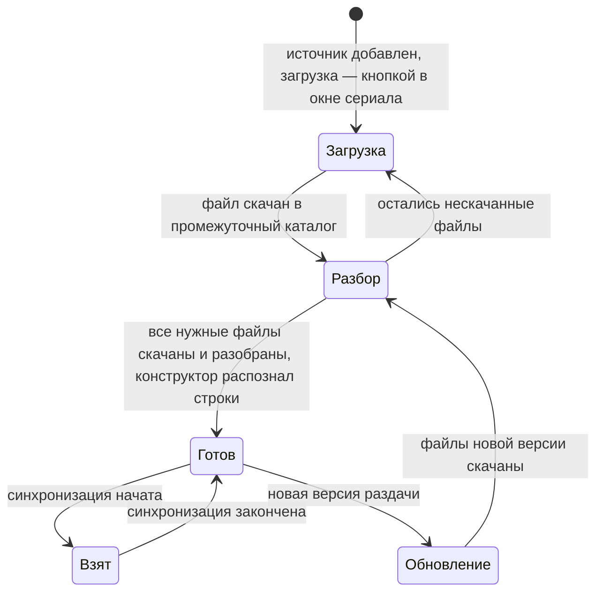

# Этап 15 — источник торрент: устройство

Состояние: к согласованию, 2026-11-16. Требования — [ЭТАП_15.md](ЭТАП_15.md).

Торрент — обычный источник сериала: тот же путь «сайт → таблица строк → конструктор правил → планировщик», что у VK и
сайтов, равный участник выхода (РЕФ, озвучки, субтитры). Истина о раздаче — скачанный файл. Таблицу даёт отдельный блок разбора контейнеров: строка — одна дорожка вместе с
видео своего файла; многодорожечный файл — несколько строк.

## 1. Термины

| Термин | Значение |
|---|---|
| Раздача | один торрент (infohash): то, что даёт страница трекера или результат поиска |
| Промежуточный каталог | место загрузки раздач под исходными именами файлов, вне каталога выходных файлов; файлы ждут синхронизации, выходной файл из них собирает планировщик |
| Разбор контейнеров | отдельный блок торрент-источника со своими правилами: читает файлы раздачи (дорожки, их названия, язык, вид, каталоги) и даёт таблицу строк в нынешнем виде; к сайтам не применяется |
| Строка дорожки | строка таблицы: одна звуковая или субтитровая дорожка вместе с видео своего файла — как строка сайта (видео и озвучка) |
| Видео файла | видеопоток файла раздачи; одно у всех строк дорожек этого файла и внешних файлов, отнесённых к нему |

## 2. Три вида торрент-источников

| Вид | Пример | Страница | Где обновление | Часть таблицы |
|---|---|---|---|---|
| Раздача | kinozal, rutracker | одна раздача | внутри раздачи: новый infohash, новые файлы | раздача; новая версия заменяет прежнюю |
| Каталог раздач тайтла | anistar, anilibria | anistar — как сайты: одно видео, одна дорожка; anilibria — раздача на качество, в разбор поступает одна раздача выбранного качества | новые раздачи на странице и новые версии прежних (anistar); растущий диапазон той же раздачи (anilibria) | раздача; новая версия заменяет прежнюю |
| Поиск | nyaa | `сайт \| запрос`, как канал VK | новые результаты поиска | каждая отобранная раздача |

Все три — сайты общего протокола `Site` (`modules/sources/sites`), таблица читается `TableReader`, источник
добавляется как сайт. В этап входит перенос существующих торрент-сайтов (`modules/sources`: kinozal, rutracker,
anilibria, astar, anilibria_tv); новые сайты, в том числе nyaa, вводятся позже, полнота поиска nyaa проверяется при его
введении. Несколько раздач на одну серию (пак и одиночные, разные раздающие) — несколько кандидатов серии;
их выбирают те же рычаги, что выбирают между плеерами: у строки потока на месте плеера — раздача.

| Что | Как устроено (`modules/sources/sites/trackers.py`, `core/contracts/torrent.py`) |
|---|---|
| Адрес страницы | одно написание на домене трекера (`kinozal.tv`, `rutracker.org`, `anilibria.top`, `anilibria.tv`, `astar.bz`), какое бы зеркало ни было в адресе; зеркала — из настроек трекеров |
| Раздачи страницы | `sources.releases.get {url}` — чтение трекера нынешними разборщиками; `release` — id раздачи на странице, один у всех её версий: `page` у страницы одной раздачи, качество у каталога «раздача на качество» (anilibria, anilibria_tv), серии и качество у каталога «раздача на серию» (astar) |
| Таблица страницы | дорожки скачанных и разобранных раздач: чтение таблицы не ходит на трекер, а спрашивает `unpack.table.get`; `unpack.table.changed` — таблица читается заново |
| Плеер строки | `torrent:<release>` — линия плеера `torrent`; раздачи выбираются как плееры |
| Ссылка строки | `torrent:<release>/<видеофайл>#<поток>`, у внешней дорожки `?file=<файл>`; тождество видео строки — видеофайл в раздаче, в каком бы файле ни лежала дорожка; потока у хоста нет: дорожку берёт синхронизация из файла |

## 3. Жизнь источника

Загрузка раздачи — не часть синхронизации.



| Состояние источника | Для синхронизации |
|---|---|
| Загрузка, разбор (первая версия) | источника в сериале нет: сериал в том состоянии, что до добавления; синхронизация остальных источников идёт как обычно |
| Готов | синхронизация берёт его в работу в том состоянии, что на момент её начала (слепок входов прогона) |
| Взят (идёт синхронизация) | обновление раздачи не начинается: файлы нужны в том виде, что есть; начинается по событию конца синхронизации |
| Обновление | раздача недоступна целиком: работы из её файлов нет; собранное из неё в библиотеке остаётся и участвует как есть |

- Обновление файлов раздачи — независимая от синхронизации конструкция: проверка сайта, новый `.torrent`, загрузка,
  разбор — со своим запуском (кнопка, автообновление), не внутри прохода синхронизации.
- Синхронизация берёт файлы раздачи, только когда раздача загружена и разобрана.
- Во время обновления раздача недоступна целиком. Пример: скачаны 12 серий, синхронизации
  ещё не было; раздача обновилась — качается 13-я серия, заменяются 3 файла с добавленными озвучками; запущена
  синхронизация, РЕФ назначен на торрент — планировщик отмечает недоступность РЕФ и берёт запасной по порядку РЕФ, без
  запасного у серии состояние «нет референса».
- Видео раздачи, уже собранное в библиотеку, остаётся кандидатом РЕФ наравне с онлайн-строками (`core/plan/planner.py`,
  `_goal`: путь «asset»): недоступность раздачи на него не действует.
- Копий файлов при обновлении нет: новая версия обновляет файлы раздачи на месте.
- Удаление промежуточных файлов снимает раздачу с раздачи в qBittorrent; рейтинг трекеров причиной хранить файлы не
  является (дублирование недопустимо).
- Файл разбирается, как только скачан он сам; строки дорожек появляются пофайлово. Состояние загрузки и разбора видно
  в существующих окнах источников; расшифровка раздачи — во вкладке редактора торрента (раздел 4.1).
- Обновление раздачи: сайт опрашивается, изменилась дата — получается новый `.torrent` и заменяет прежний; новая версия
  кладётся в тот же промежуточный каталог, qBit засчитывает прежние файлы, качаются только новые, разбираются заново
  только изменившиеся.
- Тождество файла между версиями — путь в раздаче. Переименованный раздающим файл — новый файл; прежний уходит по
  правилу хранения (раздел 3а).
- Видеодорожка файла для одного источника всегда признаётся неизменной: новая версия
  файла по тому же пути — то же видео; выровненное к нему остаётся, добавленные дорожки приходят новыми строками.
  Тождество видео строки — путь файла в раздаче (`TableRow.video`), содержимое видео не хешируется.
- Раздача только с magnet: список файлов получается нынешним алгоритмом (метаданные через qBit).
- Путь промежуточного каталога — настройка приложения; очередь и число одновременных загрузок — параметры qBittorrent.

### Обновление в qBittorrent (замер 2026-11-16, qBittorrent 5.2.1)

Сырьё — `data/raw/qbit_behaviour__20261116T195834Z__probe.jsonl` (`tools/collectors/qbit_behaviour.py`): синтетические
версии v1 и v2 одной раздачи на настоящем клиенте; в v2 после E02 вставлен новый E03, `old_name.mkv` переименован в
E04, внешний звук E01 заменён на месте.

| Наблюдение | Значение для торрент-источника |
|---|---|
| Раздача, добавленная остановленной, файлы на диске не проверяет: прогресс 0 до явного пересчёта; добавленная запущенной — проверяет сама, с тем же итогом, что пересчёт (0,5985) | новая версия добавляется запущенной в тот же каталог: проверка и докачка — без отдельных команд и без ожиданий |
| Команда запуска, отданная во время пересчёта, теряется: после проверки раздача остановлена | `torrents` не запускает раздачу во время проверки |
| Пересчёт остановленной раздачи данные не пишет (время изменения файлов прежнее), раздача остаётся остановленной | проверка новой версии безопасна для собранного |
| Неполные после пересчёта файлы qBittorrent переименовывает в `<имя>.!qB` (настройка клиента `incomplete_files_ext`) | на время обновления пути файлов на диске меняются — раздача недоступна целиком (раздел 3); читается только файл с прогрессом 1, имя — из ответа qBittorrent |
| Неизменённый файл рядом с новым или изменённым теряет общий кусок (E02: 0,9917) и докачивает его тем же содержимым | тождество файла — путь; докачка граничного куска его не меняет |
| Переименованный раздающим файл качается заново целиком; прежний остаётся на диске | `torrents` удаляет файлы прежней версии, которых нет в новой, когда новая скачана |
| Удаление раздачи с файлами удаляет только её файлы (в том числе `.!qB`) и опустевшие каталоги; каталог с чужим файлом остаётся | удаление источника снимает раздачу с файлами и затем убирает свой промежуточный каталог |
| Размер и остаток раздачи (`size`, `amount_left`, `progress`) считаются кусками: нужный кусок — задевающий нужный файл; у остановленной раздачи после смены приоритета они прежние, пока она не запущена; прогресс файла — по байтам и всегда текущий | готовность раздачи и файла `torrents` берёт из прогресса файлов |
| Файл с приоритетом 0 при запуске не создаётся; запуск без раздающих ничего не пишет | исключённые сезоны и серии не занимают места |
| Пути контейнера qBittorrent: `/downloads` ↔ `/home/user/qbit/downloads`, `/nas` ↔ `/nas` | промежуточный каталог — на `/nas`: путь одинаков у приложения и у клиента |

Модель клиента для тестов и стенда — `tests/qbit_model.py` (WebAPI на настоящем HTTP); её ответы на том же сценарии сверяются с
замером (`tests/samples/qbit/update_5_2_1.json`, `tests/test_qbit_model.py`).

## 3а. Хранение промежуточных файлов и жизнь видео торрента

| Тип | Назначение | Промежуточные файлы |
|---|---|---|
| Следимая (автообновление включено) | раздача обновляется, система следит за ней | хранятся в исходном виде: новая версия узнаёт прежние файлы, качаются только новые |
| Архивная (автообновление выключено) | раздача больше не обновляется или нужна только как сырьё и РЕФ | не хранятся: остаётся только то, что в библиотеке |

Жизненный цикл:

```
раздача добавлена, сериал выходит ── автообновление: новые версии, промежуточные файлы хранятся
        │ раздача месяцами не обновляется
        ▼
автообновление выключено ── промежуточные файлы удаляются, в библиотеке — выходные файлы
        │
        ▼
видео торрента живёт в библиотеке, пока оно РЕФ: к нему выравниваются новые озвучки
        │ нашёлся другой РЕФ
        ▼
видео торрента затирается; вернуться к нему — скачать заново
```

- Торрент — ненадёжная раздача: зависит от раздающих и может стать недоступным полностью (раздача есть, скачать не у
  кого). После выключения автообновления единственная гарантированная копия собранного — библиотека.
- Видео торрента в библиотеке — офлайн-РЕФ: путь планировщика «выходной файл держит видео» (`core/plan/planner.py`).
- Смена РЕФ: дорожки файла прежнего РЕФ (свои озвучки торрента и выровненные к нему) выравниваются из него на новый РЕФ
  (путь «выровнять из контейнера при другом видео»); видео прежнего РЕФ уходит, когда в файле больше ничего не нужно.
- Вернуться к прежнему видео торрента — скачать его заново; раздача без раздающих — строка «не получено»
  (`RowState.NOT_OBTAINED`), а не ошибка серии.
- Строки разбора раздачи после удаления промежуточных файлов остаются в таблице: невзятая дорожка видна; взять её —
  скачать её файл заново.
- Хранение при автообновлении — свойство раздачи, а не сайта: новая версия бывает у раздач всех существующих
  торрент-сайтов (замена `rolling` и `fixed`, `modules/scan/torrent.py`).
- Промежуточный файл, работа по которому ещё не закончена (загрузка, конформ, сборка серии), удаляется, когда она
  закончена: правило планировщика для любого файла — файл уходит, когда всё взятое из него живёт в выходных файлах.

## 3б. Таблицы

Миграция `0069_torrent_source`.

| Таблица | Владелец | Что хранит |
|---|---|---|
| `torrent_releases` | `torrents` | раздача страницы: адрес страницы и id раздачи на ней (ключ; одна загрузка на все сериалы с этим источником), название, ссылка, дата версии, infohash версии в клиенте, состояние (`listed`, `metadata`, `downloading`, `ready`, `updating`, `failed`, `archived`), причина, автообновление, промежуточный каталог |
| `torrent_release_files` | `torrents` | файл раздачи: путь в раздаче, размер, прогресс, приоритет |
| `torrent_release_versions` | `torrents` | версии раздачи: infohash, дата, когда добавлена |
| `unpack_streams` | `unpack` | потоки файла по ffprobe, вложения, главы; для какой версии и какого размера файл прочитан (иначе читается заново) |
| `unpack_folders` | `unpack` | каталоги озвучек и субтитров, созданные вручную: имя, язык, тип субтитров |
| `unpack_assignments` | `unpack` | ручные назначения: файл → сезон и серия (до `episode_last` у файла нескольких серий), дорожка или поток → каталог по имени, «Не брать» |
| `unpack_sources` | `unpack` | профили правил вкладок «Озвучки», «Субтитры», «Контейнеры» источника |
| `parser_profiles.kind` | `rules` | `series` или `torrent`: профили редактора торрента в списке правил сериала не показываются |

- Назначенное правилами не хранится: оно вычисляется из правил при каждом разборе, поэтому правило доходит до новых
  файлов обновления, а ручное назначение — нет.
- Выбор хранится в терминах домена (сезон, серия, имя каталога), а не ссылками на технические записи.
- Пустой сезон или пустая серия редактора ничего не держат и не хранятся.

## 4. Разбор контейнеров

таблицу, которую понимает конструктор, даёт отдельный блок разбора со своими правилами;
конструктор и «Выход» работают со строками как сейчас. Блок — чтение торрент-источника (место `Site.read` у сайтов):
вход — скачанные файлы раздачи, выход — строки `TableRow`.

| Правило разбора | Что даёт |
|---|---|
| Дорожка → строка | каждая звуковая и субтитровая дорожка видеофайла — строка; строка несёт видео своего файла: высоту кадра (`heights`) и тождество видео (`video` = путь файла в раздаче) |
| Внешний файл | звуковой или субтитровый файл раздачи относится к видеофайлу раздачи правилом разбора по именам и даёт строки с видео этого файла |
| Внешний звук без видео в раздаче | не обрабатывается |
| Название озвучки (`RowVoice.name`) | тег названия дорожки; у внешнего файла — имя его каталога; нет ни того, ни другого — пусто (озвучку называет конструктор) |
| Вид (`RowVoice.kind`) | звук или субтитры |
| Текст строки (`TableRow.text`) | серия и сезон от пресета в одном виде (`S01E05`) и путь файла в раздаче |
| Поля для правил | язык, номер дорожки, кодек и каналы, флаги — записями `LINE_FIELDS` (`core/contracts/release_table.py`) |
| Вложения (шрифты) | не строки: идут с субтитрами своего файла |

- Для пользователя разобранный файл с несколькими дорожками или с дорожками в каталогах выглядит в «Выходе» так же, как
  строки сайтов: каждая дорожка — озвучка, её можно свободно менять, переставлять, отключать.
- Ключ строки: путь файла + номер дорожки. Выбор пользователя хранится правилом конструктора и порядком «Выхода» в
  терминах домена и переживает замену версии раздачи.
- До загрузки номера файлам из списка `.torrent` даёт пресет по их названиям (дерево файлов известно заранее); по ним и
  по исключённым сезонам и сериям сериала ставятся приоритеты qBit. До полной загрузки источника в сериале нет.
- Для видов «каталог» и «поиск» отбор по раздаче идёт правилами до загрузки.
- Разбор не автоматический: под каждую раздачу собирается разборщик — конструктор разбора.
  Дорожки лежат в раздачах произвольно (рядом с видео, в каталогах и подкаталогах); имена дорожек внутри контейнера есть
  не всегда и бывают известны только из описания раздачи; у отдельно лежащих дорожек названия и языка нет.

### 4.1. Редактор торрента

| Вкладка | Слева | Сверху — правила | Справа — каталоги |
|---|---|---|---|
| Файлы | дерево файлов раздачи: зелёный — есть сезон и серия, красный — нет | выделенный пресет: сезон и серия по названию файла, исключения | сезон → серия, заготовки «Создать сезон», «Создать серию» |
| Озвучки | звуковые файлы чистовика «Файлы» | название и язык по пути файла | каталоги озвучек: название, язык |
| Субтитры | файлы субтитров чистовика «Файлы» | название, язык, тип по пути файла | каталоги субтитров: название, язык, тип |
| Контейнеры | контейнеры, одинаковые по составу дорожек схлопнуты | назначение дорожек по номеру, языку, тегу | каталоги озвучек и субтитров из дорожек |

Принятый макет — вкладка «Торрент» окна сериала, внутри переключатель «Файлы · Озвучки · Субтитры · Контейнеры» со
счётчиком неразобранного; на каждой вкладке сверху раскрывающаяся панель правил, снизу две панели.

| Вкладка | Поля строки для правил | Действия «ТО» | Отбор слева | Справа |
|---|---|---|---|---|
| Файлы | `D` каталог, `K` вид (видео, звук, субтитры), `X` расширение; текст — имя файла | «Извлечь номер серии», «Исключить», сезон | Все, Нет серии, Есть серия, Исключено, Не участвуют (шрифты, картинки) | «Сезон → серия → файлы»: у файла — правило и строка, по которым он лёг; «+ Сезон», «+ Серия», «Удалить», «Не брать» |
| Озвучки | `D`, `X`, `S` сезон и серия | «В каталог озвучки» (имя), «Язык» | Все, Без озвучки, В каталоге | каталоги: имя, язык, файлы, серии, источник (строка правила или «создан вручную»), строка сериала `V:<имя>` |
| Субтитры | `D`, `X`, `S` | «В каталог субтитров», «Язык», «Тип» | Все, Без каталога, В каталоге, Шрифты | каталоги: имя, язык, тип (полные, надписи, форсированные), шрифты, строка `S:<имя>` |
| Контейнеры | `T` вид, `A` номер дорожки, `L` язык, `N` тег названия, `C` кодек | «В каталог озвучки», «В каталог субтитров» | Все дорожки, Без каталога, В каталоге, Видео | общие каталоги с вкладками «Озвучки» и «Субтитры» |

- Слева выбор галочками (файл, каталог, «выбрать все из каталога»); выбранное переносится мышью на серию, сезон или
  каталог справа. Зона приёма говорит, что получится: «8 файлов лягут в серии 1–8 по порядку имён».
- Контейнеры с одинаковым составом дорожек показаны одной группой с диапазоном серий; дорожка группы выбирается и
  переносится сразу для всех её файлов.

- Назначение — каталог: его создают, называют и перетаскивают в него элементы слева. Имя каталога — название в строке
  конструктора правил сериала.
- Правило назначает и новые файлы обновлённой раздачи; ручное перетаскивание — только перетащенные.
- Строка таблицы источника — дорожка (внешний файл или поток контейнера) с видео своей серии и именем своего каталога.

## 5. Синхронность и конформ

Внутренние и внешние дорожки раздачи полностью синхронны видео раздачи своей серии.

| РЕФ серии | Дорожка раздачи | Конформ |
|---|---|---|
| видео этой раздачи | внутренняя или внешняя | нет: берётся как есть |
| другое видео | внутренняя | да: озвучка — файл раздачи, дорожка по номеру (`dub_atracks`) |
| другое видео | внешняя | да: видеочастью озвучки берётся видео раздачи этой серии; передача пары — по контракту демона (`/openapi.json`) |

## 6. Многодорожечность

Многодорожечный файл источника в «Выходе» — несколько строк-озвучек, как у сайтов; выходной файл собирается по плану:
порядок, отключение и замена дорожек — по рычагам сезона и серии наравне с дорожками других источников.

- Файл раздачи с несколькими сериями — строка-компиляция, как у VK и сайтов: без одиночной серии или эталона разметки
  разбирать её не по чему, у её серий нет РЕФ (`_cuts`, `core/plan/planner.py`). Отдельной формы выхода нет.

## 7. Планировщик и сборка

| Где | Сейчас | Нужно |
|---|---|---|
| `own_track`, `core/plan/planner.py` | у видео один свой звук; строки с разными ключами — разные видео | строки с одним тождеством видео (`video`) — одно видео (так `TableRow.video` и описан в контракте таблицы); свои дорожки видео — все такие строки; при РЕФ из раздачи они не выравниваются |
| Вариант (озвучка, источник, плеер) | плеер — способ получения видео | у строки потока — раздача |
| Загрузка строки | строка качается загрузчиком | файл уже в промежуточном каталоге: шаг — взять поток N копированием (`AudioIn.stream`, `core/container.py`) |
| Субтитры | нет ни в планировщике, ни в сборке | раздел 7.1 |
| Главы | сборка их сбрасывает (`-map_chapters -1`, `core/container.py`) | раздел 7.2 |

### 7.0. Шкала видео (инварианты шага 6)

| № | Инвариант | Как держится |
|---|---|---|
| И-1 | Шкала строки — ключ её видео как шкалы: строки одного источника с одной шкалой показывают одно видео и в такт друг другу | поле строки `TableRow.timeline` (пусто — ключ самой строки); у сайта строка одна на видео, шкала — она сама; у торрента шкала всех дорожек файла — сам видеофайл (`<release>/<путь>`) |
| И-2 | Видео плана и выровненное к нему узнаются по шкале, а не по строке | ключ видео — шкала; выбор другой дорожки того же файла своим звуком видео не меняет: файл, сборка и выровненное остаются |
| И-3 | Дорожки строк со шкалой видео серии берутся как есть, без выравнивания | путь `timeline` (звук строки-шкалы), сейчас только у нарезки, — для любого видео |
| И-4 | Строка торрента не скачивается: её файл в промежуточном каталоге раздачи; планировщик этот файл не удаляет и не переносит | шаг взятия дорожки читает файл раздачи на месте; файлы раздачи уходят только через `torrents.release.drop_files` |
| И-5 | Дорожка торрента к чужому РЕФ — конформ: озвучка — видеофайл раздачи этой серии, дорожка — номер звука в нём; у внешней — пара «видео раздачи + файл дорожки» | внутренняя — по нынешнему контракту демона (`dubs`, `dub_atracks`); пары в контракте нет (`/openapi.json`, 2026-11-17): внешняя дорожка к чужому РЕФ пропускается на синхронизацию с причиной `conform_pair_unsupported`, берётся следующий источник; копия видео ради пары не делается; задача демона — Т-13 ([TRACK_MUXER_SUBTITLES_CHAPTERS.md](TRACK_MUXER_SUBTITLES_CHAPTERS.md)) |
| И-6 | У сериалов сайтов план не меняется | у их строк шкала = строка; ключи и метки собранных файлов те же; база прода: 1 пара «страница + видео» из 27 269 с двумя строками (карточка приложения, серии 558/559) |

### 7.1. Субтитры

| Что | Как |
|---|---|
| Перенос к чужому РЕФ | переносятся любые субтитры (текстовые, картинные, ASS целиком) |
| Управление | как у звука: включение, отключение, порядок по уровням |
| Таблица порядка | одна таблица субтитров на серию и одна на сериал (не по озвучкам): в ней выставляется, какие субтитры первые, вторые и так далее |
| Форсированные | признак «форсированные / нет» присваивается в редакторе торрента |
| Шрифты | вложения-шрифты идут с субтитрами ASS своего файла |

- Упаковка выходного контейнера — дело приложения (`core/container.py`, копирование потоков); демон в ней не участвует.
  Субтитры из файла, чьё видео — РЕФ серии, копируются в контейнер как есть. Сейчас сборка их не берёт (`-map` только
  видео и звука) — это правка приложения в этом этапе.
- Демон нужен только субтитрам из файла, чьё видео не РЕФ: их время переносится на шкалу РЕФ, как звук при конформе.
  Сейчас (`/openapi.json`, 2026-11-16) демон переносит только текстовые субтитры, лежащие файлом рядом с озвучкой
  (`TextTrackReport`), выбрасывает векторные рисунки ASS (`dropped_drawings`), картинные не переносит, карту времени
  задачи наружу не отдаёт. Перенос субтитров — задача демона:
  [TRACK_MUXER_SUBTITLES_CHAPTERS.md](TRACK_MUXER_SUBTITLES_CHAPTERS.md).

### 7.2. Главы

| Что | Как |
|---|---|
| Главы файла, чьё видео — РЕФ | копируются в выходной файл как есть |
| Главы источника, выровненного к РЕФ | переносятся демоном на шкалу РЕФ при конформе, как субтитры |
| Выбор | главы РЕФ всегда в приоритете; у РЕФ глав нет — главы первого по порядку озвучек сезона выровненного источника, у которого они есть |

## 8. Что уходит и что пересматривается

| Что | Сейчас | После |
|---|---|---|
| Пауза до переименования (Р-14), стадии переименования и recheck | файлы переименовываются в qBit и лежат в каталоге выходных файлов | в новой модели не используются: файлы раздачи под исходными именами в промежуточном каталоге; код не удаляется до приёмки этапа — удаление отдельным решением |
| `sources.parse`, торрентная ветка `scan`, `REPLACE_MODE` (`modules/scan/torrent.py`) | отдельный канал торрентов | общий путь `Site` → таблица → конструктор |
| `torrents` | конвейер раздачи до медиатеки | исполнитель загрузок в промежуточный каталог |
| `SeriesKind` (торрент или видео) | вид сериала | нет: у сериала источники любых видов |
| Д-38, Д-39, требование 1 и критерий «торрент-сериалы как раньше» (CHARTER) | торрент-путь не меняется | пересматриваются этим этапом |
| Торрент-сериалы прода (39, 58, 67, 86, 87) | файлы раздач в библиотеке, раздаются qBit оттуда | не переносятся: удаляются |
| Не-видео файлы раздачи | приоритет 0, не качаются (`modules/torrents/selection.py`) | качаются и дают строки |

## 9. Открыто

| # | Вопрос | Чьё решение |
|---|---|---|
| — | Открытых вопросов нет | — |

## 10. Порядок работы

1. Корпус реальных разборов: раздачи существующих торрент-сайтов, включая файлы без тегов названия, смену состава дорожек
   посреди сезона, внешние папки звука и субтитров, одну озвучку в 2.0 и 5.1. Снимки — вне git.
2. Блок разбора контейнеров: правила дорожек, названий, внешних файлов; проверка на корпусе.
3. Жизнь источника: промежуточный каталог, очередь, пофайловый разбор, версии раздачи, хранение, отбор по раздаче.
4. Планировщик и сборка: свои дорожки видео, взятие потока из промежуточного файла, субтитры.
