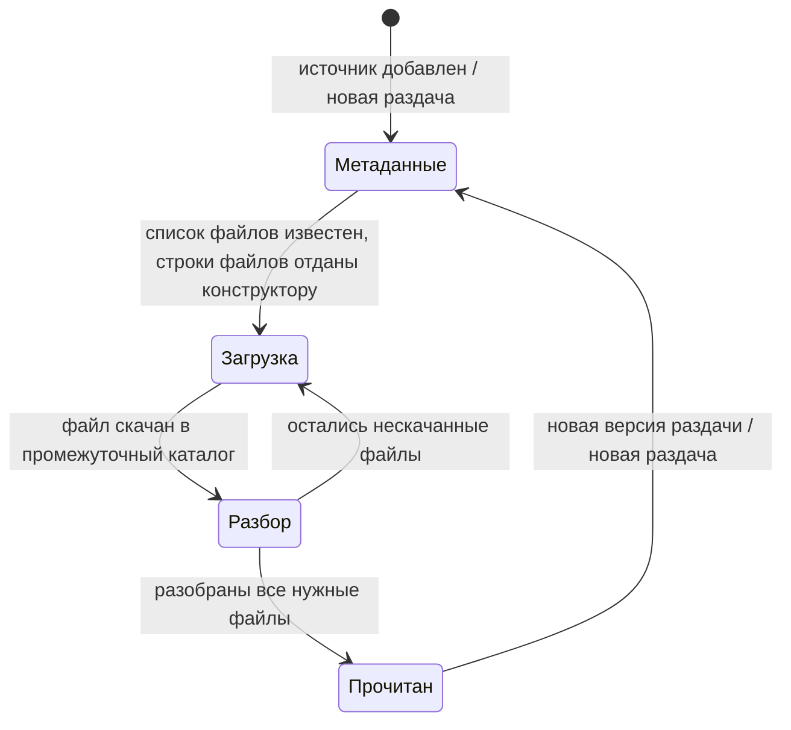

# Этап 15 — источник торрент: устройство

Состояние: к согласованию, 2026-11-15; решения владельца 2026-11-15 (расшифровка — конструктором, синхронность дорожек
раздачи, без отдельной вкладки) внесены. ТЗ дословно — [ЭТАП_15.md](ЭТАП_15.md).

Торрент — обычный источник сериала: тот же путь «сайт → таблица строк → конструктор правил → планировщик», что у VK и
сайтов, равный участник выхода (РЕФ, озвучки, субтитры). Истина о раздаче — скачанный файл. Строка конструктора — один
поток одного файла раздачи; многодорожечный файл — несколько строк.

## 1. Термины

| Термин | Значение |
|---|---|
| Раздача | один торрент (infohash): то, что даёт страница трекера или результат поиска |
| Промежуточный каталог | место загрузки раздач под исходными именами файлов, вне каталога выходных файлов; файлы ждут синхронизации, выходной файл из них собирает планировщик |
| Разбор файла | чистая функция: вывод ffprobe по файлу раздачи → строки таблицы, по строке на каждый поток; ничего не отсеивает |
| Строка потока | строка таблицы: один поток (видео, звук, субтитры, вложение) одного файла раздачи |
| Видео раздачи серии | видеопоток файла раздачи, которому конструктор дал серию |
| Свои дорожки видео | звуковые и субтитровые потоки, синхронные видео раздачи серии: потоки того же контейнера и внешние файлы той же раздачи и той же серии |

## 2. Три вида торрент-источников

| Вид | Пример | Страница | Где обновление | Часть таблицы |
|---|---|---|---|---|
| Раздача | kinozal, rutracker | одна раздача | внутри раздачи: новый infohash, новые файлы | раздача; новая версия заменяет прежнюю |
| Каталог раздач тайтла | anistar | список раздач (серия, несколько серий, пак) | новые раздачи на странице | каждая раздача |
| Поиск | nyaa | `сайт \| запрос`, как канал VK | новые результаты поиска | каждая отобранная раздача |

Все три — сайты общего протокола `Site` (`modules/sources/sites`), таблица читается `TableReader`, источник
добавляется как сайт. Несколько раздач на одну серию (пак и одиночные, разные раздающие) — несколько кандидатов серии;
их выбирают те же рычаги, что выбирают между плеерами: у строки потока на месте плеера — раздача.

## 3. Жизнь источника



- Работа с источником начинается с загрузки раздачи в промежуточный каталог; источник прочитан, когда разобраны все
  нужные файлы. Загрузки ждут своей очереди.
- Файл разбирается, как только скачан он сам; строки потоков появляются пофайлово.
- Состояние загрузки и разбора — состояние чтения таблицы источника (`TableProgress`, события модуля), в существующих
  окнах источников. Отдельной вкладки торрент-источников нет.
- Новая версия раздачи кладётся в тот же промежуточный каталог под теми же исходными именами; qBit засчитывает
  совпавшее, разбираются заново только изменившиеся файлы.
- Часть таблицы, которую прочитать не удалось (`.torrent` не получен, файл не скачан), — непрочитанная часть
  (`ReleaseTable.unread`): строки, данные ею прежде, сохраняются.

## 4. Строки для конструктора

Конструктор один — модуль `rules`. Строка потока — строка таблицы с новыми колонками; в текст для конструктора они входят
записями `LINE_FIELDS` (`core/contracts/release_table.py`, `line_of`) с кодами:

| Код | Поле |
|---|---|
| `F` | путь файла в раздаче (с папками) |
| `K` | вид потока: `video`, `audio`, `sub`, `attach` |
| `T` | номер потока в своём виде: `v0`, `a1`, `s0` |
| `L` | язык |
| `N` | тег названия потока |
| `C` | кодек, каналы |
| `FL` | флаги: по умолчанию, форсированный |
| `R` | высота кадра видеопотока (существующее поле) |

Пример строк одной серии:

```
PID:kinozal.tv | Владыка… | F:Season 1/Ep01.mkv          | K:video | T:v0 | R:1080p | C:hevc
PID:kinozal.tv | Владыка… | F:Season 1/Ep01.mkv          | K:audio | T:a1 | L:rus | N:AniLibria | C:aac 2.0
PID:kinozal.tv | Владыка… | F:Rus Sound/Studio X/Ep01.mka | K:audio | T:a0 | L:rus | C:ac3 5.1
PID:kinozal.tv | Владыка… | F:Season 1/Ep01.mkv          | K:sub   | T:s0 | L:rus | N:Надписи | C:ass | FL:forced
PID:kinozal.tv | Владыка… | F:Fonts/arial.ttf            | K:attach
```

| Что | Как |
|---|---|
| Серия | правилом по `F`: действует на все строки файла, у каждой строки путь её файла |
| Озвучка, название субтитров | правилом по `N`, папке в `F` или `T` в диапазоне серий; внутренняя и внешняя дорожка назначаются одинаково; без назначения — «Неизвестная озвучка N» (требование 15 CHARTER) |
| Исключение | правилом: оригинал, комментарии, лишнее |

Строки появляются в два приёма:

1. До загрузки: по строке на файл из списка `.torrent` (`F`, размер). Конструктор даёт серию; исключённые сезоны и серии
   не качаются.
2. После загрузки: файл раскрывается в строки потоков; правила по `F` продолжают действовать.

- Ключ строки: путь файла + номер потока. Номер потока между файлами ничего не значит: выбор пользователя хранится
  правилом конструктора в терминах домена и переживает замену версии раздачи.
- Для видов «каталог» и «поиск» отбор по раздаче (заголовок, раздающий, разрешение, размер, сиды) идёт правилами до
  загрузки: в промежуточный каталог попадают только отобранные раздачи.

## 5. Синхронность и конформ

Внутренние и внешние дорожки раздачи полностью синхронны видео раздачи своей серии (решение владельца 2026-11-15).

| РЕФ серии | Дорожка раздачи | Конформ |
|---|---|---|
| видео этой раздачи | внутренняя или внешняя | нет: берётся как есть |
| другое видео | внутренняя | да: озвучка — файл раздачи, дорожка по номеру (`dub_atracks`) |
| другое видео | внешняя | да: видеочастью озвучки берётся видео раздачи этой серии; передача пары — по контракту демона (`/openapi.json`) |

## 6. Многодорожечность

Многодорожечный файл источника управляется как выходной файл: видны его дорожки, каждая — строка с назначенной
озвучкой или названием субтитров; в выход дорожки идут по порядку и рычагам сезона и серии наравне с дорожками других
источников.

## 7. Планировщик и сборка

| Где | Сейчас | Нужно |
|---|---|---|
| `own_track`, `core/plan/planner.py` | у видео один свой звук | набор своих дорожек видео (раздел 1); при РЕФ из раздачи они не выравниваются |
| Вариант (озвучка, источник, плеер) | плеер — способ получения видео | у строки потока — раздача |
| Загрузка строки | строка качается загрузчиком | файл уже в промежуточном каталоге: шаг — взять поток N копированием (`AudioIn.stream`, `core/container.py`) |
| Субтитры | нет ни в планировщике, ни в сборке | дорожки субтитров в выходном файле со своим порядком; вложения-шрифты идут с субтитрами ASS; субтитры к чужому РЕФ переносятся демоном на его шкалу |

## 8. Что уходит и что пересматривается

| Что | Сейчас | После |
|---|---|---|
| Пауза до переименования (Р-14), стадии переименования и recheck | файлы переименовываются в qBit и лежат в каталоге выходных файлов | не нужны: файлы раздачи под исходными именами в промежуточном каталоге |
| `sources.parse`, торрентная ветка `scan`, `REPLACE_MODE` (`modules/scan/torrent.py`) | отдельный канал торрентов | общий путь `Site` → таблица → конструктор |
| `torrents` | конвейер раздачи до медиатеки | исполнитель загрузок в промежуточный каталог |
| `SeriesKind` (торрент или видео) | вид сериала | нет: у сериала источники любых видов |
| Д-38, Д-39, требование 1 и критерий «торрент-сериалы как раньше» (CHARTER) | торрент-путь не меняется | пересматриваются этим этапом |
| Не-видео файлы раздачи | приоритет 0, не качаются (`modules/torrents/selection.py`) | качаются и дают строки |

## 9. Открыто

| # | Вопрос | Чьё решение |
|---|---|---|
| 1 | Жизнь промежуточного файла: удаляется после сборки выходного или остаётся для раздачи и следующей версии | владелец |
| 2 | Тот же файл в новой версии раздачи (переименован, пересобран): по чему опознаётся | инварианты по корпусу |
| 3 | Полнота поиска nyaa (страницы, RSS) | измерение |
| 4 | Источник только с magnet: метаданные через qBit и DHT | по корпусу |

## 10. Порядок работы

1. Корпус реальных разборов: раздачи всех трёх видов, включая файлы без тегов названия, смену состава дорожек посреди
   сезона, внешние папки звука и субтитров, одну озвучку в 2.0 и 5.1. Снимки — вне git.
2. Разбор файла и колонки строки для конструктора; проверка на корпусе.
3. Жизнь источника: промежуточный каталог, очередь, пофайловый разбор, версии раздачи, отбор по раздаче.
4. Планировщик и сборка: свои дорожки видео, взятие потока из промежуточного файла, субтитры.
