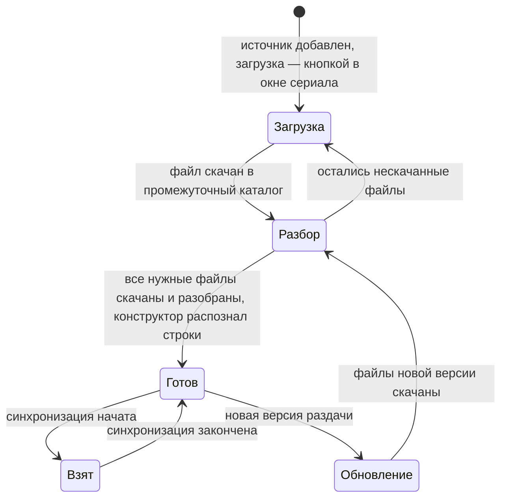

# Этап 15 — источник торрент: устройство

Состояние: к согласованию, 2026-11-16; решения владельца 2026-11-15 и 2026-11-16 (расшифровка — конструктором, синхронность дорожек
раздачи, без отдельной вкладки, хранение промежуточных файлов, тождество файла по пути, состав сайтов этапа, жизненный цикл видео торрента, загрузка вне синхронизации, недоступность раздачи на время обновления, неизменность видеодорожки) внесены.
ТЗ дословно — [ЭТАП_15.md](ЭТАП_15.md).

Торрент — обычный источник сериала: тот же путь «сайт → таблица строк → конструктор правил → планировщик», что у VK и
сайтов, равный участник выхода (РЕФ, озвучки, субтитры). Истина о раздаче — скачанный файл. Строка конструктора — один
поток одного файла раздачи; многодорожечный файл — несколько строк.

## 1. Термины

| Термин | Значение |
|---|---|
| Раздача | один торрент (infohash): то, что даёт страница трекера или результат поиска |
| Промежуточный каталог | место загрузки раздач под исходными именами файлов, вне каталога выходных файлов; файлы ждут синхронизации, выходной файл из них собирает планировщик |
| Разбор файла | чистая функция: вывод ffprobe по файлу раздачи → строки таблицы, по строке на каждый поток; ничего не отсеивает |
| Строка потока | строка таблицы: один поток (видео, звук, субтитры, вложение) одного файла раздачи |
| Видео раздачи серии | видеопоток файла раздачи, которому конструктор дал серию |
| Свои дорожки видео | звуковые и субтитровые потоки, синхронные видео раздачи серии: потоки того же контейнера и внешние файлы той же раздачи и той же серии |

## 2. Три вида торрент-источников

| Вид | Пример | Страница | Где обновление | Часть таблицы |
|---|---|---|---|---|
| Раздача | kinozal, rutracker | одна раздача | внутри раздачи: новый infohash, новые файлы | раздача; новая версия заменяет прежнюю |
| Каталог раздач тайтла | anistar, anilibria | список раздач (серия, несколько серий, пак; у anilibria — по раздаче на качество) | новые раздачи на странице и новые версии прежних: тот же диапазон серий с новой датой (astar), растущий диапазон той же раздачи (anilibria) | каждая раздача; новая версия заменяет прежнюю |
| Поиск | nyaa | `сайт \| запрос`, как канал VK | новые результаты поиска | каждая отобранная раздача |

Все три — сайты общего протокола `Site` (`modules/sources/sites`), таблица читается `TableReader`, источник
добавляется как сайт. В этап входит перенос существующих торрент-сайтов (`modules/sources`: kinozal, rutracker,
anilibria, astar, anilibria_tv); новые сайты, в том числе nyaa, вводятся позже, полнота поиска nyaa проверяется при его
введении. Несколько раздач на одну серию (пак и одиночные, разные раздающие) — несколько кандидатов серии;
их выбирают те же рычаги, что выбирают между плеерами: у строки потока на месте плеера — раздача.

## 3. Жизнь источника

Загрузка раздачи — не часть синхронизации (решение владельца 2026-11-16).



| Состояние источника | Для синхронизации |
|---|---|
| Загрузка, разбор (первая версия) | источника в сериале нет: сериал в том состоянии, что до добавления; синхронизация остальных источников идёт как обычно |
| Готов | синхронизация берёт его в работу в том состоянии, что на момент её начала (слепок входов прогона) |
| Взят (идёт синхронизация) | обновление раздачи не начинается: файлы нужны в том виде, что есть; начинается по событию конца синхронизации |
| Обновление | раздача недоступна целиком: работы из её файлов нет; собранное из неё в библиотеке остаётся и участвует как есть |

- Обновление файлов раздачи — независимая от синхронизации конструкция: проверка сайта, новый `.torrent`, загрузка,
  разбор — со своим запуском (кнопка, автообновление), не внутри прохода синхронизации.
- Синхронизация берёт файлы раздачи, только когда раздача загружена и разобрана.
- Во время обновления раздача недоступна целиком (решение владельца 2026-11-16). Пример: скачаны 12 серий, синхронизации
  ещё не было; раздача обновилась — качается 13-я серия, заменяются 3 файла с добавленными озвучками; запущена
  синхронизация, РЕФ назначен на торрент — планировщик отмечает недоступность РЕФ и берёт запасной по порядку РЕФ, без
  запасного у серии состояние «нет референса».
- Видео раздачи, уже собранное в библиотеку, остаётся кандидатом РЕФ наравне с онлайн-строками (`core/plan/planner.py`,
  `_goal`: путь «asset»): недоступность раздачи на него не действует.
- Копий файлов при обновлении нет: новая версия обновляет файлы раздачи на месте.
- Файл разбирается, как только скачан он сам; строки потоков появляются пофайлово. Состояние загрузки и разбора видно
  в существующих окнах источников; отдельной вкладки торрент-источников нет.
- Обновление раздачи: сайт опрашивается, изменилась дата — получается новый `.torrent` и заменяет прежний; новая версия
  кладётся в тот же промежуточный каталог, qBit засчитывает прежние файлы, качаются только новые, разбираются заново
  только изменившиеся.
- Тождество файла между версиями — путь в раздаче. Переименованный раздающим файл — новый файл; прежний уходит по
  правилу хранения (раздел 3а).
- Видеодорожка файла для одного источника всегда признаётся неизменной (решение владельца 2026-11-16): новая версия
  файла по тому же пути — то же видео; выровненное к нему остаётся, добавленные дорожки приходят новыми строками.
  Номера видео (`TableRow.video`) строка торрента не несёт: видео узнаётся по ключу строки (`assets_against`,
  `core/plan/inputs.py`). Содержимое видео не хешируется.
- Раздача только с magnet: список файлов получается нынешним алгоритмом (метаданные через qBit).
- Загрузки ждут своей очереди.

## 3а. Хранение промежуточных файлов и жизнь видео торрента

Решения владельца 2026-11-15 и 2026-11-16.

| Тип | Назначение | Промежуточные файлы |
|---|---|---|
| Следимая (автообновление включено) | раздача обновляется, система следит за ней | хранятся в исходном виде: новая версия узнаёт прежние файлы, качаются только новые |
| Архивная (автообновление выключено) | раздача больше не обновляется или нужна только как сырьё и РЕФ | не хранятся: остаётся только то, что в библиотеке |

Жизненный цикл:

```
раздача добавлена, сериал выходит ── автообновление: новые версии, промежуточные файлы хранятся
        │ раздача месяцами не обновляется
        ▼
владелец выключает автообновление ── промежуточные файлы удаляются, в библиотеке — выходные файлы
        │
        ▼
видео торрента живёт в библиотеке, пока оно РЕФ: к нему выравниваются новые озвучки
        │ нашёлся другой РЕФ
        ▼
видео торрента затирается; вернуться к нему — скачать заново
```

- Торрент — ненадёжная раздача: зависит от раздающих и может стать недоступным полностью (раздача есть, скачать не у
  кого). После выключения автообновления единственная гарантированная копия собранного — библиотека.
- Видео торрента в библиотеке — офлайн-РЕФ: путь планировщика «выходной файл держит видео» (`core/plan/planner.py`).
- Смена РЕФ: дорожки файла прежнего РЕФ (свои озвучки торрента и выровненные к нему) выравниваются из него на новый РЕФ
  (путь «выровнять из контейнера при другом видео»); видео прежнего РЕФ уходит, когда в файле больше ничего не нужно.
- Вернуться к прежнему видео торрента — скачать его заново; раздача без раздающих — строка «не получено»
  (`RowState.NOT_OBTAINED`), а не ошибка серии.
- Строки разбора раздачи после удаления промежуточных файлов остаются в таблице: невзятая дорожка видна; взять её —
  скачать её файл заново.
- Хранение при автообновлении — свойство раздачи, а не сайта: новая версия бывает у раздач всех существующих
  торрент-сайтов (замена `rolling` и `fixed`, `modules/scan/torrent.py`).
- Промежуточный файл, работа по которому ещё не закончена (загрузка, конформ, сборка серии), удаляется, когда она
  закончена: правило планировщика для любого файла — файл уходит, когда всё взятое из него живёт в выходных файлах.

## 4. Строки для конструктора

Конструктор один — модуль `rules`. Строка потока — строка таблицы с новыми колонками; в текст для конструктора они входят
записями `LINE_FIELDS` (`core/contracts/release_table.py`, `line_of`) с кодами:

| Код | Поле |
|---|---|
| `F` | путь файла в раздаче (с папками) |
| `K` | вид потока: `video`, `audio`, `sub`, `attach` |
| `T` | номер потока в своём виде: `v0`, `a1`, `s0` |
| `L` | язык |
| `N` | тег названия потока |
| `C` | кодек, каналы |
| `FL` | флаги: по умолчанию, форсированный |
| `R` | высота кадра видеопотока (существующее поле) |

Пример строк одной серии:

```
PID:kinozal.tv | Владыка… | F:Season 1/Ep01.mkv          | K:video | T:v0 | R:1080p | C:hevc
PID:kinozal.tv | Владыка… | F:Season 1/Ep01.mkv          | K:audio | T:a1 | L:rus | N:AniLibria | C:aac 2.0
PID:kinozal.tv | Владыка… | F:Rus Sound/Studio X/Ep01.mka | K:audio | T:a0 | L:rus | C:ac3 5.1
PID:kinozal.tv | Владыка… | F:Season 1/Ep01.mkv          | K:sub   | T:s0 | L:rus | N:Надписи | C:ass | FL:forced
PID:kinozal.tv | Владыка… | F:Fonts/arial.ttf            | K:attach
```

| Что | Как |
|---|---|
| Серия | правилом по `F`: действует на все строки файла, у каждой строки путь её файла |
| Озвучка, название субтитров | правилом по `N`, папке в `F` или `T` в диапазоне серий; внутренняя и внешняя дорожка назначаются одинаково; без назначения — «Неизвестная озвучка N» (требование 15 CHARTER) |
| Исключение | правилом: оригинал, комментарии, лишнее |

Строки появляются в два приёма:

1. До загрузки: по строке на файл из списка `.torrent` (`F`, размер). Конструктор даёт серию; исключённые сезоны и серии
   не качаются.
2. После загрузки: файл раскрывается в строки потоков; правила по `F` продолжают действовать.

- Ключ строки: путь файла + номер потока. Номер потока между файлами ничего не значит: выбор пользователя хранится
  правилом конструктора в терминах домена и переживает замену версии раздачи.
- Для видов «каталог» и «поиск» отбор по раздаче (заголовок, раздающий, разрешение, размер, сиды) идёт правилами до
  загрузки: в промежуточный каталог попадают только отобранные раздачи.

## 5. Синхронность и конформ

Внутренние и внешние дорожки раздачи полностью синхронны видео раздачи своей серии (решение владельца 2026-11-15).

| РЕФ серии | Дорожка раздачи | Конформ |
|---|---|---|
| видео этой раздачи | внутренняя или внешняя | нет: берётся как есть |
| другое видео | внутренняя | да: озвучка — файл раздачи, дорожка по номеру (`dub_atracks`) |
| другое видео | внешняя | да: видеочастью озвучки берётся видео раздачи этой серии; передача пары — по контракту демона (`/openapi.json`) |

## 6. Многодорожечность

Многодорожечный файл источника управляется как выходной файл: видны его дорожки, каждая — строка с назначенной
озвучкой или названием субтитров; в выход дорожки идут по порядку и рычагам сезона и серии наравне с дорожками других
источников.

## 7. Планировщик и сборка

| Где | Сейчас | Нужно |
|---|---|---|
| `own_track`, `core/plan/planner.py` | у видео один свой звук | набор своих дорожек видео (раздел 1); при РЕФ из раздачи они не выравниваются |
| Вариант (озвучка, источник, плеер) | плеер — способ получения видео | у строки потока — раздача |
| Загрузка строки | строка качается загрузчиком | файл уже в промежуточном каталоге: шаг — взять поток N копированием (`AudioIn.stream`, `core/container.py`) |
| Субтитры | нет ни в планировщике, ни в сборке | дорожки субтитров в выходном файле со своим порядком; вложения-шрифты идут с субтитрами ASS; субтитры к чужому РЕФ переносятся демоном на его шкалу |

## 8. Что уходит и что пересматривается

| Что | Сейчас | После |
|---|---|---|
| Пауза до переименования (Р-14), стадии переименования и recheck | файлы переименовываются в qBit и лежат в каталоге выходных файлов | не нужны: файлы раздачи под исходными именами в промежуточном каталоге |
| `sources.parse`, торрентная ветка `scan`, `REPLACE_MODE` (`modules/scan/torrent.py`) | отдельный канал торрентов | общий путь `Site` → таблица → конструктор |
| `torrents` | конвейер раздачи до медиатеки | исполнитель загрузок в промежуточный каталог |
| `SeriesKind` (торрент или видео) | вид сериала | нет: у сериала источники любых видов |
| Д-38, Д-39, требование 1 и критерий «торрент-сериалы как раньше» (CHARTER) | торрент-путь не меняется | пересматриваются этим этапом |
| Не-видео файлы раздачи | приоритет 0, не качаются (`modules/torrents/selection.py`) | качаются и дают строки |

## 9. Открыто

| # | Вопрос | Чьё решение |
|---|---|---|
| 1 | Удаление архивной раздачи снимает её с раздачи в qBit: учитывать ли рейтинг трекеров | владелец |

## 10. Порядок работы

1. Корпус реальных разборов: раздачи существующих торрент-сайтов, включая файлы без тегов названия, смену состава дорожек
   посреди сезона, внешние папки звука и субтитров, одну озвучку в 2.0 и 5.1. Снимки — вне git.
2. Разбор файла и колонки строки для конструктора; проверка на корпусе.
3. Жизнь источника: промежуточный каталог, очередь, пофайловый разбор, версии раздачи, хранение, отбор по раздаче.
4. Планировщик и сборка: свои дорожки видео, взятие потока из промежуточного файла, субтитры.
